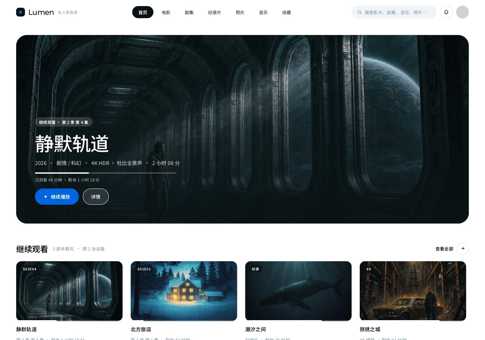
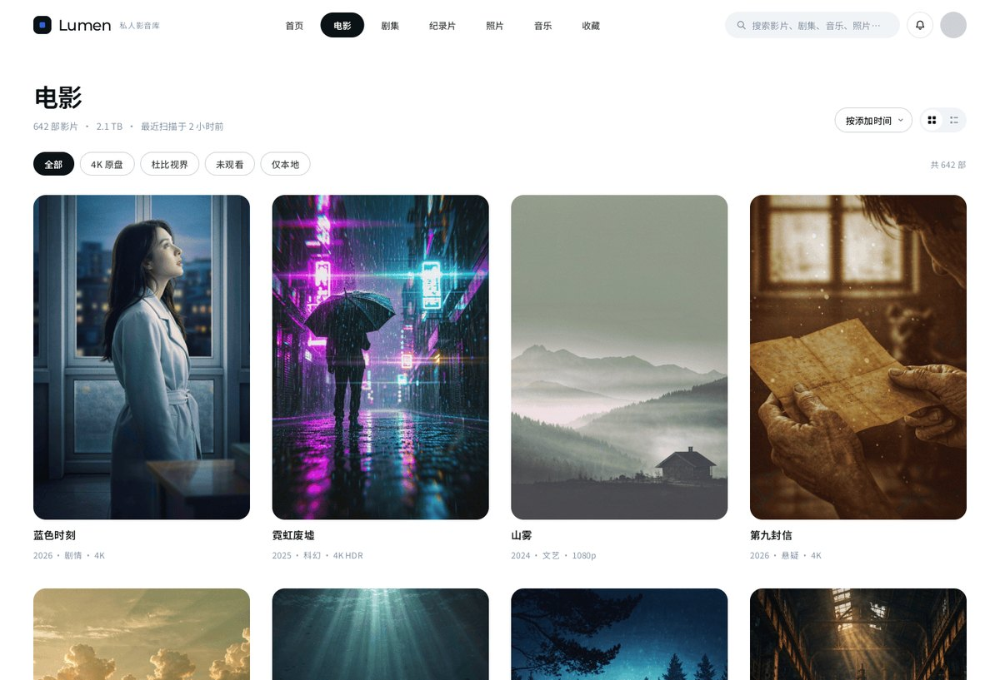
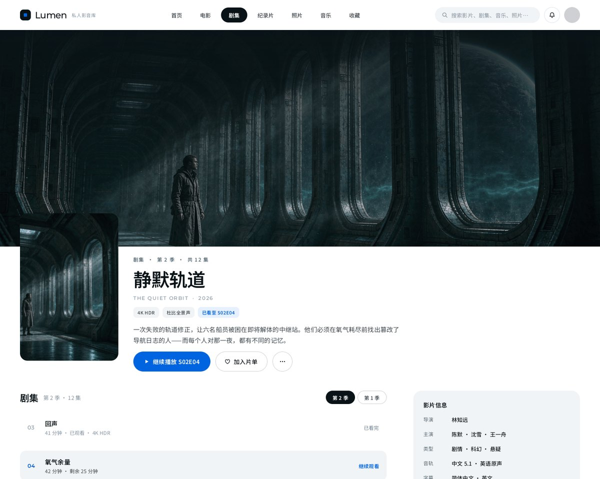
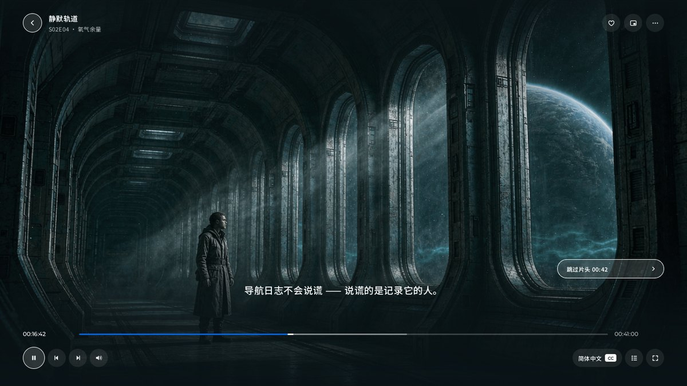
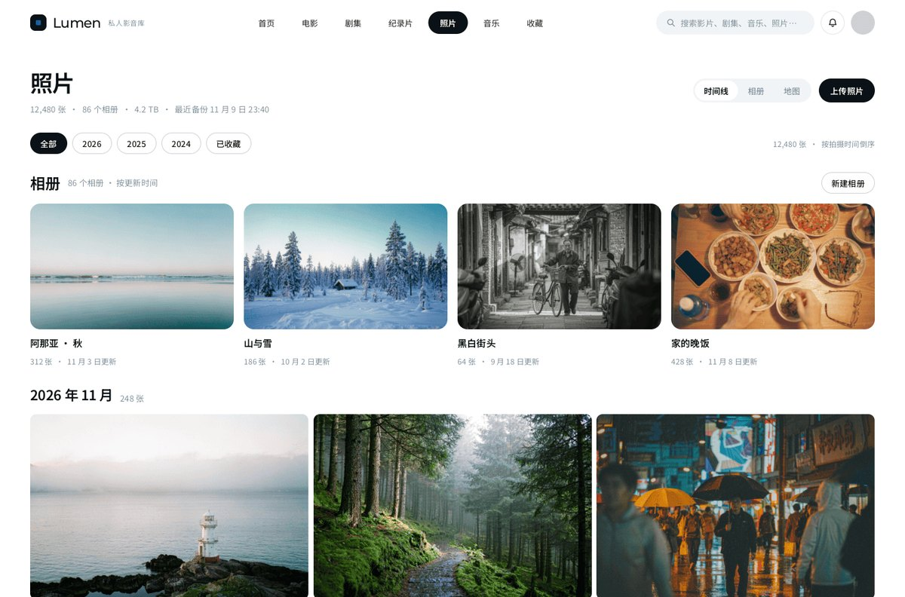
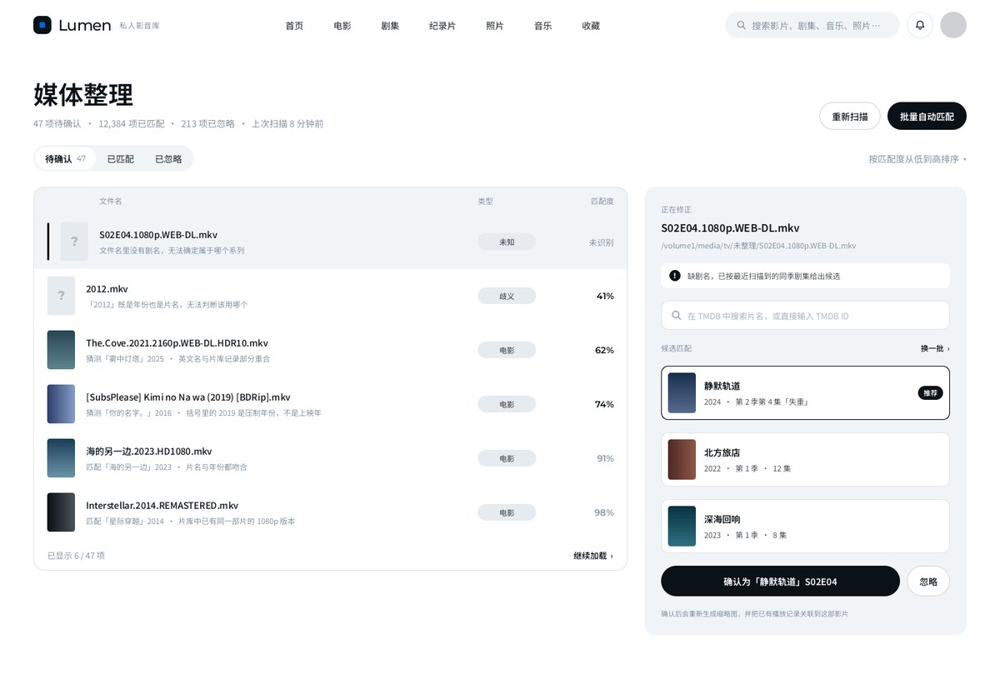
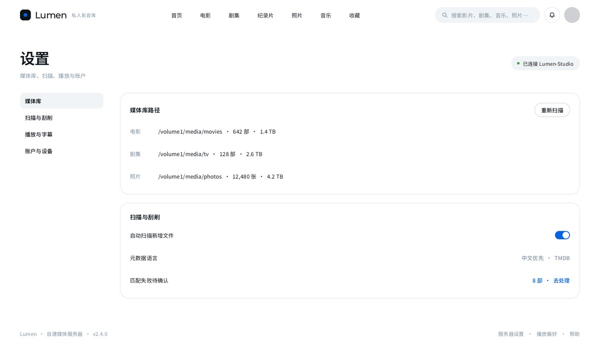
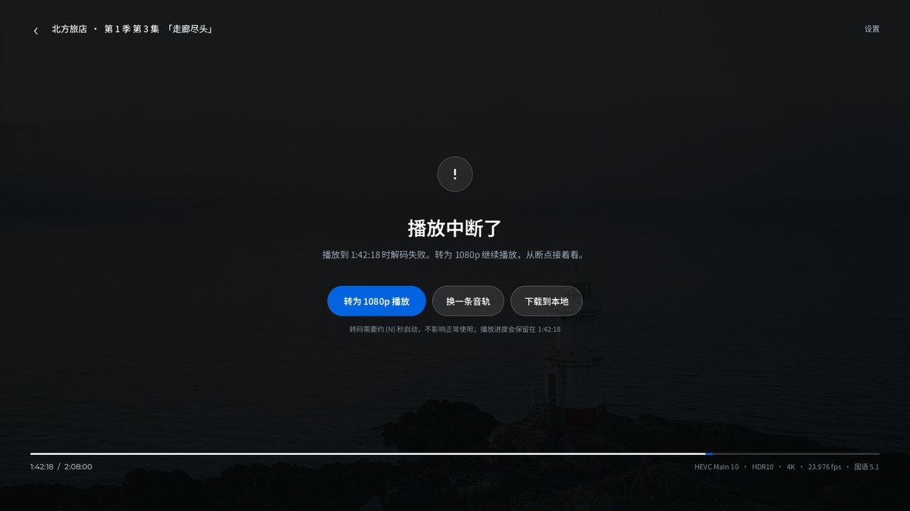

# Lumen

**A personal, self-hosted media library** — your videos, photos and music, served from your own machine, played on your own devices.

> **Status: pre-alpha.** The interface is designed (32 screens) and the HTTP API is specified; the server implementation starts now.
> Everything in `screenshots/` comes from that design set — **titles, posters and people are fictional placeholder content**, not real media.

---

## Why another media server

Three things that existing tools get in the way of:

**1. Play first, diagnose later.**
Most players run a capability probe before the first frame — a few seconds of spinner to tell you what you already knew. Lumen starts playing immediately and only intervenes when something actually fails. If a file can't be played directly, you get one screen that explains it in one sentence and offers one action, not a settings panel.

**2. Works with whatever the host happens to be.**
A NAS, a gaming desktop, a retired laptop. Hardware encoding is detected at runtime and measured, not assumed — a machine with NVENC starts a transcode in seconds, a two-core NAS takes longer, and both are described honestly instead of promising "8 seconds" to everyone.

**3. Your files stay your files.**
No import step, no re-encode of the library, no account, no cloud round-trip. Point it at folders and it plays them.

## Screens

| Library | Title detail |
|---|---|
|  |  |

| Photo timeline | Organize unmatched files |
|---|---|
|  |  |

| Settings | Playback interrupted |
|---|---|
|  |  |

## How playback works

One question at play time: *can this device open this file as-is?*

| Mode | When | Cost |
|---|---|---|
| **Direct** | Container and codecs are supported by the player | None — the file is streamed untouched |
| **Remux** | Container is unsupported but the streams are fine (`mkv` → `fMP4/HLS`) | Re-packages bytes, no re-encode |
| **Transcode** | Codec, resolution or bitrate genuinely can't be handled | Encodes; queued behind the host's capacity |

Capability is split into two kinds on purpose: *facts* about a container are used to decide how to start, while *probabilistic* capabilities (hardware decoders, HDR handling, audio routing) are only used to pick a fallback after something failed. Whether a file opens is knowable up front; whether it decodes cleanly is only knowable by trying.

## Components

| Piece | What it is | State |
|---|---|---|
| `lumen-server` | Go. Scanning, indexing, metadata, streaming, job queue | starting |
| `lumen-desktop` | Tauri shell with an embedded mpv render surface | design done |
| TV / tablet / phone | Native clients over the same HTTP API | design done |
| API | OpenAPI 3.1 description, 30 operations | specified |

All clients talk to the same server over one HTTP API, plus a single event stream for task and device state.

See [`docs/architecture.md`](docs/architecture.md) for the shape of it.

## Requirements

- A machine that stays on (NAS, desktop, mini PC) — Windows or Linux first, macOS later
- Rust-free install: the server is a single static binary
- No external account. Metadata lookup uses TMDB and is optional

## Roadmap

- [x] Interface design — 32 screens
- [x] HTTP API specification — 30 operations
- [ ] Server: scan, index, direct play
- [ ] Desktop client: browse + play
- [ ] Remux path, then transcode with queue admission
- [ ] TV / mobile clients

## Metadata

Title, poster, backdrop and episode data are provided by [TMDB](https://www.themoviedb.org/). Nothing else about your library leaves the machine, and no media is uploaded anywhere.

Metadata fetched from TMDB is cached locally for no longer than six months, and the cache can be cleared from settings at any time.

### Attribution

This product uses the TMDB API but is not endorsed or certified by TMDB.

The TMDB logo and the notice above are shown in the application's *About* section, and are never more prominent than Lumen's own branding.

## License

[MIT](LICENSE)

---

## 中文简介

Lumen 是一个**自托管的私人影音库**：把电影、剧集、照片、音乐指向你本机的文件夹，就能在自己的电脑、平板和电视上浏览和播放。

三条设计主张：

- **先播再报错** —— 起播前不做耗时探测，直接播；播不了才用一屏说清原因，并给一个能点的动作
- **不预设主机形态** —— NAS、台式机、旧笔记本都行，转码能力运行时实测，不写死「8 秒」
- **文件仍在原处** —— 不导入、不转码整库、不要账号、不连云

当前处于 pre-alpha：32 屏界面设计与 30 个接口的契约已完成，服务端实现刚开始。`screenshots/` 里的图来自设计稿，片名与海报均为虚构占位内容。

片名、海报、剧集信息来自 TMDB；元数据本地缓存不超过六个月，可在设置中随时清空。
