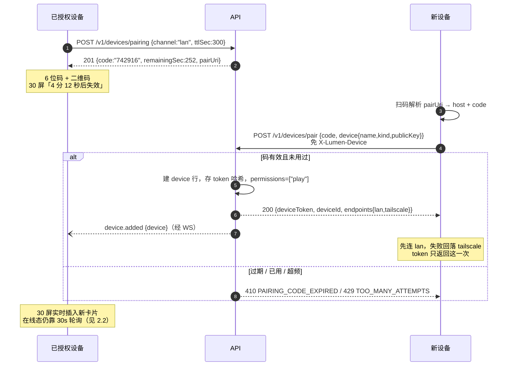
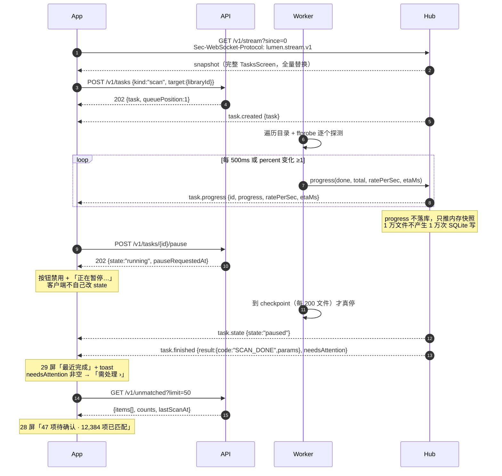
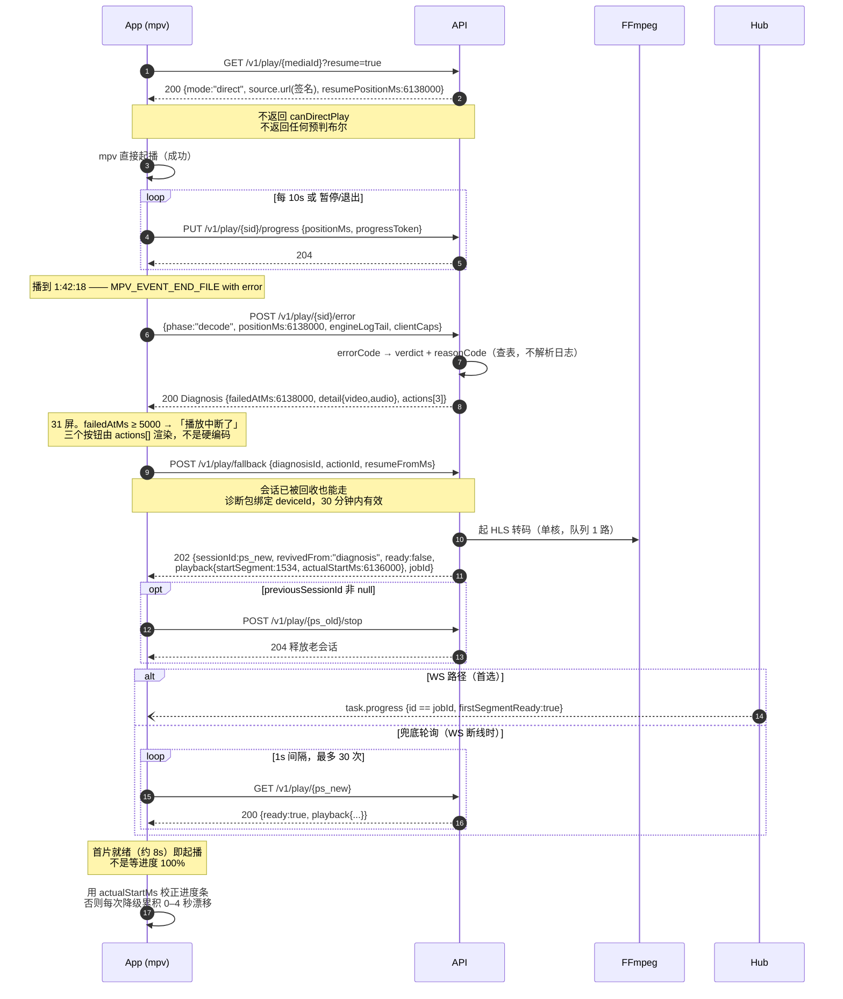

# Lumen · API 契约 v1

> 范围：媒体整理（28 屏）、任务（29 屏）、设备（30 屏）、播放能力与降级（31/32 屏 + 24 屏设置面板）、设置（07 屏）。
> 服务端 Go + SQLite，客户端 Tauri/React 与 React Native 共用此契约。
> 字段表可 1:1 转 OpenAPI 3.1，需要 YAML 版本随时说。

---

## 0. 前置约定

### 0.1 传输与版本

| 项 | 约定 |
|---|---|
| Base URL | `http://<host>:8686/api/v1`（内网直连） / `http://100.88.4.1:8686/api/v1`（Tailscale） |
| 版本 | 路径前缀 `/v1`；破坏性变更才升 v2，新增字段不升版 |
| 编码 | UTF-8，`Content-Type: application/json`，`Accept-Encoding: gzip` |
| 时间 | RFC 3339 带时区偏移，如 `2026-11-10T23:04:00+08:00` |
| 时长 | 一律整数毫秒，字段名以 `Ms` 结尾（`durationMs`、`positionMs`） |
| 体积 | 字节整数，字段名以 `Bytes` 结尾 |
| 布尔 | 真布尔，禁止 `0/1`、`"true"` |

> 上一轮口头写的是 `/api/unmatched` 等，落地统一加 `/v1`——客户端要跟着服务端协议演进，前缀是几乎零成本的保险。
> 下文小节标题里省略了 `/v1`（写作 `GET /api/unmatched`），均指 `/api/v1/unmatched`；第 5 节总表是完整路径。

### 0.2 认证与设备身份

所有请求带 `X-Lumen-Device: <deviceToken>`。token 在配对时一次性下发（见 3.4），之后存在客户端安全存储里。

服务端由 token 反查 `deviceId`，**不信任请求体里自报的设备标识**。这决定了第 4 组的所有判断都基于"服务端眼里你是谁"，而不是客户端声称自己是谁。

| 头 | 必需 | 说明 |
|---|---|---|
| `X-Lumen-Device` | 是 | 设备 token（32 字节 base62） |
| `X-Lumen-Request-Id` | 否 | 客户端生成的请求 id，回显到响应与错误体，用于串联日志 |
| `Idempotency-Key` | 写操作建议 | 见 0.5 |

未认证 → `401 UNAUTHORIZED`；token 已被撤销 → `401 DEVICE_REVOKED`（客户端应清本地状态并回到配对页）。

### 0.3 命名与单位

- JSON 字段 **camelCase**（Go struct 用 `json:"camelCase"` tag），枚举值 **snake_case** 小写。
- 资源 id 一律字符串 ULID 带类型前缀：`um_`（未识别项）、`md_`（媒体）、`tk_`（任务）、`dev_`（设备）、`ps_`（播放会话）、`dg_`（诊断）。
- 数组字段永远给 `[]` 不给 `null`；可空标量给 `null` 并显式在字段表里标注。
- **禁止**在响应里出现 HTML 片段或已拼好的中文长句（见 0.6）。

### 0.4 错误体

所有非 2xx 同构：

```json
{
  "error": {
    "code": "TASK_NOT_FOUND",
    "message": "task not found",
    "detail": { "taskId": "tk_01JCV8Q2" },
    "requestId": "req_7f3a",
    "retryable": false
  }
}
```

| 字段 | 类型 | 说明 |
|---|---|---|
| `code` | string | 大写下划线枚举，**客户端按 code 分支，不解析 message** |
| `message` | string | 英文短句，只进日志，不给用户看 |
| `detail` | object\|null | 结构化上下文，字段随 code 变 |
| `requestId` | string | 回显 `X-Lumen-Request-Id`，没有则服务端生成 |
| `retryable` | bool | 客户端可直接据此决定是否显示"重试" |

通用 code：`UNAUTHORIZED` / `DEVICE_REVOKED` / `FORBIDDEN` / `NOT_FOUND` / `VALIDATION_FAILED` / `CONFLICT` / `RATE_LIMITED` / `INTERNAL` / `SERVICE_UNAVAILABLE`。

### 0.5 分页与幂等

**分页**（列表类一律游标，不用 offset——未识别列表会边处理边变化，offset 会跳项）：

```
GET ...?limit=50&cursor=eyJvIjo2fQ
```

| 入参 | 类型 | 默认 | 约束 |
|---|---|---|---|
| `limit` | int | 50 | 1–200 |
| `cursor` | string | 空 | 不透明 base64，客户端不得解析；空表示第一页 |

响应固定形状：`{ "items": [...], "nextCursor": "..."|null, "total": 47, "counts": {...}, "countsAsOf": "..." }`。`nextCursor == null` 表示没有下一页。`total` 是当前筛选条件下的总数（可能随扫描变化）。

**已定（决策 4）：`counts` 与 `items` 在同一事务内取，不缓存、不节流。**

最初我担心 `COUNT(*)` 慢，建议 30 秒缓存。这个判断是错的：`status` 上有索引，12,384 行的 `COUNT(*)` 是亚毫秒级，而缓存的代价是三件事——28 屏三个 tab 的数字在用户刚匹配完一条时不动；`scanInProgress` 期间数字和列表对不上；以及多一条"为什么数字没变"的客服路径。

`countsAsOf` 仍然加进响应，值 = 响应生成时刻。它现在没有信息量，但它是为"将来真要缓存"留的落点：到那天只改服务端实现，客户端不用改。真到几十万行再加，`SQLite COUNT(*)` 在 50 万行 + 索引下也不过几毫秒，这个优化不着急。

**幂等**：`POST` 类写操作支持 `Idempotency-Key`，24 小时内同 key 同 body 返回首次结果（含 201）。同 key 不同 body → `409 IDEMPOTENCY_CONFLICT`。

### 0.6 文案规则（贯穿全部 4 组）

这是整套契约最容易写错的地方，先定死：

> **服务端只给"数字 + 原因码 + 参数"，客户端负责渲染成中文句子。**

理由：同一条数据在桌面端、移动端、tvOS 上句子长度和语序不同；翻译和文案迭代不应发服务端版本。

| 界面元素 | 服务端给 | 客户端渲染 |
|---|---|---|
| 28 屏「47 项待确认 · 12,384 项已匹配 · 213 项已忽略 · 上次扫描 8 分钟前」 | `counts.pending/matched/ignored` + `lastScanAt` | 拼句子 + 相对时间 |
| 28 屏每行副标「文件名里没有剧名，无法确定属于哪个系列」 | `reasonCode` + `reasonParams` | 查本地文案表 |
| 29 屏「8,486 / 12,480 · 68%」「42 张/秒」「剩余约 1 分 35 秒」 | `progress.done/total/percent/ratePerSec/etaMs` | 数字格式化 + 单位本地化 |
| 31/32 屏「当前设备无法硬解 HEVC 10bit HDR。可转为 H.264 播放…」 | `reasonCode` + `reasonParams` + `actions[].params` | 拼说明 + 拼按钮下文 |
| 31/32 屏按钮「转为 1080p 播放」 | `actions[].kind=transcode` + `params.targetHeight=1080` | 拼标签 |

例外只有两类：`title`（任务名、设备名、影片名，是**内容**不是文案）和 `action.label`（服务端可选的强制覆盖，仅用于客户端文案表未覆盖的新动作，此时客户端原样显示）。

### 0.7 「先播再报错」——这条决定第 4 组的形状

产品决策：**进播放页不做预检门禁，直接拿直连源起播；播不动了再报错。**

契约层面必须体现为三条硬规则，否则实现时一定会退回成"先探测再播放"：

**规则 1：`GET /api/play/{mediaId}` 默认返回 `mode:"direct"`，不因为"可能播不了"而转码。**
服务端只在**确定不可能**时直接降级（判定表见 4.1）。"不确定"一律给直连，让客户端先试。

**规则 2：诊断接口不得出现在起播路径上。**
`/capability` 是**可选**接口，只允许两种调用时机：① 播放已开始后（后台静默预取）；② 用户在 24 屏打开播放设置。禁止"先请求 capability，等结果再 play"——那会把起播延迟从 0 变成一次 RT 加上探测耗时。

**规则 3：`canDirectPlay` 允许为 `null`。**
`null` 的语义是"未知，需实际播放验证"。这不是偷懒，是**契约级地承认探测不可靠**：31 屏那个报错发生在 1:42:18，说明起播成功、播了一小时四十二分才崩（码率突变 / HDR 层 / 换层 / 网络塌陷）。任何请求前的探测都预言不了这种失败。所以诊断能力必须挂在**事后**，见 4.2。

**对设计稿的影响（已落地）**：原 31 屏标题是「这个文件无法直接播放」、说明是"当前设备无法硬解…可转为 H.264 播放"，这套文案对应 `failedAt ≈ 0`（起播即败）。但那一屏底部进度条写的是 `1:42:18 / 2:08:00`——**播到 1:42:18 才断**，此时说"无法直接播放"是错的，用户刚刚直接播放了一个多小时。

已把这一屏拆成两版，契约里用 `failedAtMs < 5000` 选分支：

| 屏 | `failedAtMs` | 标题 | 说明 | 进度条 |
|---|---|---|---|---|
| `12:837` 31 播放器 · 播放中断 | ≥ 5000 | 播放中断了 | 播放到 1:42:18 时解码失败。转为 1080p 继续播放，从断点接着看。 | 1:42:18，蓝点在断点 |
| `12:876` 32 播放器 · 无法直接播放 | < 5000 | 这个文件无法直接播放 | 当前设备无法硬解 HEVC 10bit HDR。可转为 H.264 播放，画面降到 1080p SDR。 | 0:00，蓝点在起点 |

脚注两版不同：31 屏「…播放进度会保留在 1:42:18」，32 屏「…会从头开始播放」。除标题、说明、进度条、脚注这四处，两屏其余完全一致。

---

## 1. 组 A · 媒体整理（28 屏）

数据模型：`unmatched_item` 是"扫描器认不准的一条文件记录"。状态机单向：

```
pending ──match──▶ matched（离开列表，进媒体库）
   └────ignore───▶ ignored（默认永久，可带 TTL 自动回归）
```

### 1.1 `GET /api/unmatched` — 待处理列表

**Query**

| 参数 | 类型 | 默认 | 说明 |
|---|---|---|---|
| `status` | enum | `pending` | `pending` \| `matched` \| `ignored`；对应顶部三个 tab |
| `mediaType` | enum | 全部 | `unknown` \| `ambiguous` \| `movie` \| `episode` \| `music` \| `photo` |
| `sort` | enum | `confidence_asc` | `confidence_asc`（设计稿默认：按匹配度从低到高）\| `confidence_desc` \| `name_asc` \| `mtime_desc` |
| `q` | string | — | 文件名子串，≤200 字符，服务端做 FTS5 前缀匹配 |
| `libraryId` | string | — | 限定媒体库 |
| `cursor` / `limit` | | | 见 0.5 |

**200**

```json
{
  "items": [
    {
      "id": "um_01JCV8Q2XK",
      "fileName": "S02E04.1080p.WEB-DL.mkv",
      "relPath": "未整理/S02E04.1080p.WEB-DL.mkv",
      "libraryId": "lib_tv",
      "sizeBytes": 2184949760,
      "mtime": "2026-11-08T22:41:07+08:00",
      "mediaType": "episode",
      "status": "pending",
      "confidence": 0,
      "reasonCode": "EPISODE_WITHOUT_SERIES",
      "reasonParams": { "season": 2, "episode": 4, "candidates": 3 },
      "thumbUrl": null,
      "parsed": {
        "title": null, "year": null,
        "season": 2, "episode": 4,
        "resolution": "1080p", "source": "WEB-DL",
        "releaseGroup": null
      },
      "probe": {
        "durationMs": 2820000, "container": "matroska",
        "width": 1920, "height": 1080,
        "videoCodec": "hevc", "audioCodec": "eac3"
      },
      "createdAt": "2026-11-10T23:04:12+08:00",
      "updatedAt": "2026-11-10T23:04:12+08:00"
    }
  ],
  "nextCursor": "eyJvIjo2fQ",
  "total": 47,
  "counts": { "pending": 47, "matched": 12384, "ignored": 213 },
  "countsAsOf": "2026-11-10T23:33:04+08:00",
  "lastScanAt": "2026-11-10T23:33:00+08:00",
  "scanInProgress": false
}
```

**字段**

| 字段 | 类型 | 可空 | 说明 / 约束 |
|---|---|---|---|
| `id` | string | 否 | `um_` 前缀，全部写操作的主键 |
| `fileName` | string | 否 | 纯文件名，含扩展名，≤512 |
| `relPath` | string | 否 | **相对媒体库根**的路径，统一 `/` 分隔，**不含盘符、不含卷名、不以 `/` 开头**。用于右栏"路径"行与去重。见下方说明 |
| `libraryId` | string | 否 | 归属媒体库，`lib_` 前缀 |
| `sizeBytes` | int64 | 否 | 文件大小 |
| `mtime` | string | 否 | 文件修改时间，不是扫描时间 |
| `mediaType` | enum | 否 | `unknown` 类型判不出；`ambiguous` 多个类型都像（UI 显示"歧义"）；其余为已判定类型 |
| `status` | enum | 否 | `pending` \| `matched` \| `ignored` |
| `confidence` | float | 否 | `0.0`–`1.0`。**`0` 表示未识别**，客户端显示「未识别」而非「0%」；`>0` 显示 `round(x*100)%` |
| `reasonCode` | enum | 否 | 见下表，驱动每行副标文案 |
| `reasonParams` | object | 否 | 与 reasonCode 配套，无参数给 `{}` |
| `thumbUrl` | string | 是 | 已生成缩略图的直链（带签，TTL 24h）；`null` → 客户端画问号占位（28 屏第一行） |
| `parsed` | object | 否 | 文件名解析结果，供右栏"已识别"提示与调试 |
| `parsed.title` | string | 是 | 解析出的片名，失败为 `null` |
| `parsed.year` | int | 是 | 年份；歧义场景（`2012.mkv`）此处为 `null` 并由 reasonCode 说明 |
| `parsed.season` / `episode` | int | 是 | 剧集号，仅 episode 有意义 |
| `parsed.resolution` | string | 是 | `2160p` / `1080p` / `720p` / `null` |
| `parsed.source` | string | 是 | `WEB-DL` / `BluRay` / `HDTV` / `null` |
| `parsed.releaseGroup` | string | 是 | `[SubsPlease]` 之类 |
| `probe` | object | 是 | ffprobe 结果；探测失败为 `null`（损坏文件常见） |
| `probe.durationMs` | int | 否 | |
| `probe.container` | string | 否 | `matroska` / `mp4` / `avi` |
| `probe.width` / `height` | int | 否 | |
| `probe.videoCodec` / `audioCodec` | string | 否 | ffprobe 原始 codec 名小写 |
| `createdAt` / `updatedAt` | string | 否 | |

**为什么 `relPath` 是相对路径、且不返回绝对路径**

因为服务端可能跑在用户自己的电脑上，媒体可能在外接硬盘或网络盘：

- Windows 上 `D:\Media` 拔插一次可能变成 `E:\Media`；macOS 的 `/Volumes/xxx` 同理。**绝对路径不是稳定标识**，把它返回给客户端等于把"盘符会变"这个坑外传。
- 服务端内部用 `volume_id + rel_path` 寻址（见技术框架 §1.2），`relPath` 已经是剥掉卷之后的部分。
- 右栏"路径"行要显示完整位置时，客户端拼 `{libraryName}/{relPath}` 即可——库里已有库名，不需要服务端传。
- 分隔符统一 `/`，**不跟随平台**（Windows 后端也返回 `未整理/xxx.mkv`）。客户端按需转 `\`，否则同一份响应在不同平台渲染出的路径不同。

**`reasonCode` 枚举（驱动 28 屏副标）**

| code | 语义 | `reasonParams` | 设计稿对应文案 |
|---|---|---|---|
| `EPISODE_WITHOUT_SERIES` | 有季集号但文件名没剧名 | `{season, episode, candidates}` | 文件名里没有剧名，无法确定属于哪个系列 |
| `YEAR_OR_TITLE_AMBIGUOUS` | 数字既像年份又像片名 | `{token}` | 「2012」既是年份也是片名，无法判断该用哪个 |
| `TITLE_YEAR_OVERLAP` | 片名部分重合多部 | `{guessedTitle, guessedYear, matchedTitle, matchedYear, overlap}` | 疑似「霓虹灯牌」2025 · 英文名与片库记录部分重合 |
| `YEAR_IS_RELEASE_TAG` | 括号内年份是压制年 | `{title, year, bracketYear}` | 括号里的 2019 是压制年份，不是上映年 |
| `STRONG_MATCH` | 片名与年份都吻合，等确认 | `{title, year, score}` | 匹配「海的另一边」2023 · 片名与年份都吻合 |
| `NEAR_DUPLICATE` | 片库已有同片其它版本 | `{title, year, existingQuality}` | 片库中已有一部 1080p 版本 |
| `MULTI_SEASON_PACK` | 整季包，需拆集 | `{seasonCount, episodeCount}` | |
| `MUSIC_NO_FINGERPRINT` | 音频指纹未命中 | `{album, trackCount}` | |
| `PHOTO_NO_EXIF` | 照片无 EXIF 时间地点 | `{count}` | |

新增 code 必须同步客户端文案表；客户端遇到未知 code 时降级显示 `fileName`，不得白屏。

### 1.2 `GET /api/unmatched/{id}/candidates` — 候选（右栏）

**Query**

| 参数 | 类型 | 默认 | 说明 |
|---|---|---|---|
| `refresh` | bool | `false` | `true` = 「换一批」，跳过缓存并换排序种子 |

**200**

```json
{
  "itemId": "um_01JCV8Q2XK",
  "basis": {
    "code": "SAME_SEASON_RECENT_SCAN",
    "params": { "season": 2, "seriesCount": 3 }
  },
  "items": [
    {
      "tmdbId": 128420,
      "mediaType": "tv",
      "title": "静默轨道",
      "originalTitle": "Silent Orbit",
      "year": 2024,
      "posterUrl": "https://...",
      "overview": "…",
      "seasonNumber": 2,
      "episodeNumber": 4,
      "episodeTitle": "失重",
      "totalSeasons": 2,
      "totalEpisodes": 16,
      "inLibrary": false,
      "score": 0.87,
      "recommended": true,
      "recommendBasis": "SAME_SEASON"
    }
  ],
  "total": 3
}
```

**字段**

| 字段 | 类型 | 可空 | 说明 |
|---|---|---|---|
| `basis.code` | enum | 否 | `SAME_SEASON_RECENT_SCAN`（驱动提示条「缺剧名。已按最近扫描到的同季剧集给出候选」）\| `FILENAME_TOKENS` \| `FINGERPRINT` \| `NONE` |
| `basis.params` | object | 否 | 渲染提示条用的数字，如 `{season, seriesCount}` |
| `tmdbId` | int | 否 | TMDB 数值 id；确认时原样回传 |
| `mediaType` | enum | 否 | `movie` \| `tv` |
| `title` | string | 否 | TMDB 标题，按库设置的 `language` 取。**无该语言译名时返回 `originalTitle` 本身**（实测回退链是 `zh-CN → 原名`，**不经过英文**），所以这里可能是韩文/日文/英文，客户端不得假设含中文 |
| `originalTitle` | string | 否 | |
| `year` | int | 是 | 首播年 |
| `posterUrl` | string | 是 | 已代理到本机，避免客户端直连 TMDB（外网不可达时也要能显示） |
| `seasonNumber` / `episodeNumber` | int | 是 | **仅当候选能落到具体集时给**，驱动「第 2 季第 4 集《失重》」 |
| `episodeTitle` | string | 是 | 集名，驱动《失重》 |
| `totalSeasons` / `totalEpisodes` | int | 是 | 驱动「2022 · 第 1 季 · 12 集」 |
| `inLibrary` | bool | 否 | 已在库内，客户端标「已在库」避免重复添加 |
| `score` | float | 否 | 0–1，服务端排序依据，客户端不显示 |
| `recommended` | bool | 否 | 驱动右上「推荐」角标；**最多 1 个为 true** |
| `recommendBasis` | enum | 是 | `SAME_SEASON` \| `SAME_SERIES` \| `EPISODE_TITLE_MATCH` \| `null` |

`refresh=true` 时服务端换排序种子（同分候选轮换），但 `recommended` 的那条必须仍然排第一——否则用户点「换一批」会丢失最佳解。

**候选数：单页硬上限 20，不翻页。** 这条现在是明文约束，不是隐含行为：没有任何 `page`/`offset` 参数，实现时也不许"顺手加一个"。依据是实测——24 条真实剧名（国产剧/日剧/韩剧/美剧/港片）走 `language=zh-CN`，`hit@5 = 96%`，正确项几乎总在前 5；多翻一页只会让全库首扫的请求数翻倍（5 万文件首扫已约 27 小时），换不回排序质量。**排序问题只能靠更好的信号解决，不能靠翻页。**

**`score` 的产生规则（服务端必须实现，否则 `recommended` 无法解释）：**

| 信号 | 权重 | 为什么必须有 |
|---|---|---|
| 标题 token 覆盖率（**不是字符串相等**） | 主 | 实测中文译名常比俗称长：`昼颜` 在 TMDB 的 zh-CN 名是 `昼颜：工作日下午3点的恋人们`。用相等判定会把正确答案判成未匹配 |
| 年份（文件名解析值 vs `first_air_date`/`release_date`，±1 年） | 高 | 两个字的短标题会被综艺抢占：`信号` 的 top1 是恋爱综艺 `心动的信号`，正确项在 rank 2 |
| 类型（`movie` / `tv` 与文件名是否带季集号一致） | 高 | 走错端点等于必然搜不到 |
| 原名语言与文件名语言是否一致 | 中 | 中文文件名配中文原名应加分，配英文原名不该减分 |
| popularity | 低 | **只能做同分时的次序**，不能做主要依据——上面两个失败案例都是 popularity 造成的 |

切片长度差异**不得**作为降权理由：译名比俗称长是常态，不是不匹配的信号。

### 1.3 `GET /api/tmdb/search` — 手动搜索

**Query**

| 参数 | 类型 | 必需 | 默认 | 说明 |
|---|---|---|---|---|
| `q` | string | 是 | | 1–200 字符。纯数字且 ≤7 位时服务端按 tmdbId 直查（对应设计稿"或直接输入 TMDB ID"） |
| `type` | enum | 否 | `multi` | `multi` \| `movie` \| `tv` |
| `year` | int | 否 | | 四位年份，过滤 |
| `limit` | int | 否 | 10 | 1–20 |

**200**

```json
{
  "query": "静默轨道",
  "resolvedBy": "title",
  "items": [ { "tmdbId": 128420, "mediaType": "tv", "title": "静默轨道", "year": 2024,
               "posterUrl": "https://...", "totalSeasons": 2, "totalEpisodes": 16,
               "inLibrary": false } ],
  "total": 1
}
```

| 字段 | 说明 |
|---|---|
| `resolvedBy` | `title` \| `tmdb_id` \| `none`；`none` 时 `items: []`，客户端显示空态而非错误 |
| 其余 | 同 1.2 候选字段（不含 `score`/`recommended`/集级字段） |

失败语义：TMDB 不可达（无外网且未配代理）→ `503 METADATA_SOURCE_UNAVAILABLE`，`detail.source="tmdb"`，`retryable=true`。**不要**把它当 404——用户需要知道是网络问题不是搜不到。

### 1.4 `POST /api/media/{id}/match` — 确认为某部影片/某一集

`{id}` 用目标记录的 `um_` id（确认后转为 `md_`，响应里返回）。

**Body**

```json
{
  "target": {
    "tmdbId": 128420,
    "mediaType": "tv",
    "seasonNumber": 2,
    "episodeNumber": 4
  },
  "applyToSiblings": true,
  "regenerateThumb": true,
  "moveToLibrary": true
}
```

| 字段 | 类型 | 必需 | 默认 | 说明 |
|---|---|---|---|---|
| `target.tmdbId` | int | 是 | | 来自候选或搜索 |
| `target.mediaType` | enum | 是 | | `movie` \| `tv` |
| `target.seasonNumber` | int | 条件 | | `mediaType=tv` 时必需 |
| `target.episodeNumber` | int | 条件 | | `mediaType=tv` 时必需 |
| `applyToSiblings` | bool | 否 | `false` | 把**同目录下同季**的其余文件按季集号一起绑定。`S02E04` 旁边的 E05–E12 靠这个一次搞定 |
| `regenerateThumb` | bool | 否 | `true` | 触发缩略图重生成（设计稿脚注承诺了这点） |
| `moveToLibrary` | bool | 否 | `true` | 从 `未整理/` 移到规范路径；`false` 则原地登记 |

**200**

```json
{
  "mediaId": "md_01JCV9A7",
  "status": "matched",
  "title": "静默轨道",
  "episodeTitle": "失重",
  "affectedMediaIds": ["md_01JCV9A7", "md_01JCV9A8"],
  "affectedCount": 2,
  "taskId": "tk_01JCV9B1",
  "thumbPending": true
}
```

| 字段 | 说明 |
|---|---|
| `mediaId` | 本条转成的媒体 id |
| `affectedMediaIds` | 含自身；`applyToSiblings` 时的全部 |
| `taskId` | 缩略图/入库任务 id，客户端拿它去 29 屏或就地 toast 跟踪；`thumbPending=false` 时为 `null` |

错误：`409 ALREADY_MATCHED`（`detail.currentMediaId`）／`422 EPISODE_OUT_OF_RANGE`（`detail.availableEpisodes`）／`409 FILE_MISSING`（扫描后被外部删除）。

**副作用契约**：入库后该记录**立即**从 `GET /api/unmatched?status=pending` 消失，`counts` 相应减少。客户端不需要本地删行——直接重取列表首屏即可（列表是游标分页，删行会让游标错位）。

### 1.5 `POST /api/media/{id}/ignore` — 忽略

**Body**

```json
{ "reason": "noise", "note": null, "ttlDays": null }
```

| 字段 | 类型 | 必需 | 默认 | 说明 |
|---|---|---|---|---|
| `reason` | enum | 否 | `other` | `noise`（花絮/样本）\| `wrong_library` \| `duplicate` \| `unsupported` \| `other` |
| `note` | string | 否 | `null` | ≤200，仅内部可见 |
| `ttlDays` | int | 否 | **`null`** | `null` = 永久忽略（**一期唯一可达值**）；>`0` = N 天后自动回归 pending。范围 1–3650 |

**200** `{ "id": "um_...", "status": "ignored", "ignoredAt": "...", "expiresAt": null }`

**已定（决策 1）：默认永久，接口能力保留，一期 UI 不给 TTL 入口。**

理由是 TTL 的代价被我最初低估了。它需要一个后台定时任务扫 `ignored_at + ttl_days < now`，而且过期项会**集体**回归 `pending`——用户会在某天打开 28 屏，看到一堆三个月前亲手忽略、文件早就删掉的记录又回来了。这比"永久忽略攒成垃圾场"更烦人，因为后者至少是用户自己的选择，前者是系统在跟他作对。

所以接口保留 `ttlDays`（服务端必须能接受并落库 `expiresAt`），一期客户端固定发 `null`。将来要开，只改 UI，不动协议。

### 1.6 `POST /api/unmatched/batch-match` — 批量自动匹配（右上按钮）

**Body**

```json
{ "threshold": 0.9, "dryRun": false, "libraryId": null, "ids": null }
```

| 字段 | 类型 | 默认 | 说明 |
|---|---|---|---|
| `threshold` | float | 0.9 | 只处理 `confidence >= threshold` 的项 |
| `dryRun` | bool | `false` | 只返回将被处理的数量与预估，不写库（给二次确认用） |
| `libraryId` | string | `null` | 限定库 |
| `ids` | string[] | `null` | 指定项；`null` = 全库按 threshold |

**200**（异步）

```json
{ "taskId": "tk_01JCV9C3", "dryRun": false, "candidateCount": 38,
  "estimatedMs": 42000, "accepted": 38, "skipped": 9 }
```

`dryRun=true` 时 `taskId=null`，客户端弹确认："38 项将被自动匹配，9 项仍待人工"。

---

## 2. 组 B · 任务（29 屏）

模型：单机**同时只跑一个重任务**（扫描/转码/刮削会抢 IO 与 CPU），其余进 FIFO 队列；支持置顶。这条约束写进服务端调度器，不由客户端保证。

任务状态机：

```
queued ──▶ running ──▶ succeeded
  ▲          │  │
  │          │  └──▶ failed ──retry──▶ queued
  └─resume── paused
             └────▶ canceled
```

### 2.1 `GET /api/tasks` — 整屏数据（一次请求）

29 屏是单屏四块（当前 / 等待 / 最近 / 定时），一次给全，避免客户端并发 4 个请求后再做时序对齐。

**Query**：`recentLimit`（默认 5，1–50）、`recentDays`（默认 7，1–90）

**200**

```json
{
  "running": {
    "id": "tk_01JCV7Z1",
    "kind": "library_scan",
    "title": "扫描照片库",
    "state": "running",
    "target": {
      "libraryId": "lib_photos",
      "displayPath": "D:/Media/photos",
      "fileCount": 12480,
      "sizeBytes": 4617089843200
    },
    "progress": {
      "done": 8486,
      "total": 12480,
      "unit": "photo",
      "percent": 68,
      "ratePerSec": 42,
      "etaMs": 95000,
      "indeterminate": false
    },
    "startedAt": "2026-11-10T23:04:00+08:00",
    "finishedAt": null,
    "canPause": true,
    "canCancel": true,
    "canRetry": false,
    "pauseRequestedAt": null,
    "result": null,
    "error": null
  },
  "queued": [
    {
      "id": "tk_01JCV7Y8",
      "kind": "library_scan",
      "title": "电影库增量扫描",
      "state": "queued",
      "target": { "libraryId": "lib_movies", "displayPath": "D:/Media/movies",
                  "fileCount": null, "sizeBytes": null },
      "progress": { "done": 0, "total": null, "unit": "file", "percent": 0,
                    "ratePerSec": null, "etaMs": 12000, "indeterminate": true },
      "queuePosition": 1,
      "etaMs": 12000,
      "estReason": "LAST_RUN",
      "priority": 100,
      "startedAt": null, "finishedAt": null,
      "canPause": false, "canCancel": true, "canRetry": false,
      "result": null, "error": null
    }
  ],
  "recent": [
    {
      "id": "tk_01JCV6Q0",
      "kind": "library_scan",
      "title": "照片库扫描",
      "state": "succeeded",
      "finishedAt": "2026-11-10T23:04:00+08:00",
      "durationMs": 252000,
      "result": {
        "code": "SCAN_DONE",
        "params": { "scanned": 12480, "added": 136, "updated": 0, "removed": 0 }
      },
      "needsAttention": null
    }
  ],
  "summary": { "runningCount": 1, "queuedCount": 2, "succeeded7d": 14, "failed7d": 0 },
  "schedule": {
    "enabled": true,
    "cron": "0 3 * * *",
    "timezone": "Asia/Shanghai",
    "nextRunAt": "2026-11-11T03:00:00+08:00",
    "skipIfNoChange": true,
    "notifyOnComplete": false
  }
}
```

**任务对象字段**

| 字段 | 类型 | 可空 | 说明 |
|---|---|---|---|
| `id` | string | 否 | `tk_` |
| `kind` | enum | 否 | `library_scan` \| `metadata_fetch` \| `thumbnail_gen` \| `subtitle_fetch` \| `music_match` \| `media_move` \| `transcode` \| `batch_match` |
| `title` | string | 否 | 任务名**是内容**，服务端给中文短名（"扫描照片库"）。这是 0.6 的例外 |
| `state` | enum | 否 | `queued` \| `running` \| `paused` \| `succeeded` \| `failed` \| `canceled` |
| `target.libraryId` | string | 是 | |
| `target.displayPath` | string | 是 | **仅用于展示**的库根路径，驱动副行 `D:/Media/photos`。会随盘符/挂载点变化，**不得用于寻址**；寻址一律用 `libraryId` |
| `target.fileCount` | int | 是 | 驱动副行 `12,480 个文件`；扫描前未知为 `null` |
| `target.sizeBytes` | int64 | 是 | 驱动 `4.2 TB`；未知为 `null` |
| `progress.done` | int | 否 | 已完成单位数 |
| `progress.total` | int | 是 | 总单位数；`null` 时 `indeterminate=true`（扫描第一遍不知道总数） |
| `progress.unit` | enum | 否 | `file` \| `photo` \| `episode` \| `album` \| `frame` \| `item`；客户端映射中文量词（张/集/张专辑/项） |
| `progress.percent` | int | 否 | 0–100 整数，服务端算好；`indeterminate` 时为 `0` |
| `progress.ratePerSec` | float | 是 | 驱动「42 张/秒」；<1 时客户端显示小数 |
| `progress.etaMs` | int | 是 | 驱动「剩余约 1 分 35 秒」；波动大，客户端做 3 次滑动平均再显示 |
| `progress.indeterminate` | bool | 否 | `true` → 进度条走 indeterminate 动画，不显示百分比 |
| `queuePosition` | int | 是 | 1-based，仅 `queued` |
| `etaMs` | int | 是 | 排队预计等待，仅 `queued` |
| `estReason` | enum | 是 | `LAST_RUN`（按上次耗时估）\| `HEURISTIC`（按文件数估）\| `null` |
| `priority` | int | 否 | 越小越前，默认 100；置顶 = 0 |
| `startedAt` / `finishedAt` | string | 是 | 驱动「开始于 23:04」「23:04」 |
| `durationMs` | int | 是 | 仅已结束任务；驱动「4 分 12 秒」 |
| `canPause` / `canCancel` / `canRetry` | bool | 否 | **按钮可用性由服务端决定**，客户端不自己判断 kind。例：`library_scan` 可暂停，`media_move` 不可暂停 |
| `pauseRequestedAt` | string | 是 | 非 `null` 表示暂停已请求、尚未在检查点停下。此时 UI 显示"正在暂停…"并禁用按钮（见 2.3） |
| `result.code` | enum | 是 | `SCAN_DONE` \| `MATCH_DONE` \| `THUMB_DONE` \| `NO_CHANGE` \| `PARTIAL` |
| `result.params` | object | 是 | 数字，驱动「12,480 张 · 新增 136 张」「匹配 46 部 · 2 项待确认」「无变化」 |
| `needsAttention` | object | 是 | `{code, params, target}`；非 `null` → 状态列显示「需处理 ›」，点击跳 `target`（29 屏第 3 行）。`target` 形如 `{route:"unmatched", filter:{status:"pending"}}` |
| `error.code` | enum | 是 | `IO_ERROR` \| `PERMISSION_DENIED` \| `SOURCE_UNAVAILABLE` \| `DISK_FULL` \| `CANCELED` \| `INTERNAL` |
| `error.message` / `error.detail` | | 是 | 同 0.4 |

给 `queued` 项算 `etaMs` 时**要把 running 的剩余时间算进去**——29 屏第二行「约 4 分钟」显然含了前面 12 秒 + 当前任务的 1 分 35 秒。

### 2.2 `WS /api/stream` — 唯一推送通道

**v1.1 变更**：原 `/api/tasks/stream` 改名为 `/api/stream`。这条通道现在不只推任务，也推设备事件；名字不改，后来的人会以为设备事件该另开一条连接，而"一个客户端只允许 1 条连接"的约束又不允许。趁还没实现改掉，零兼容成本。

**握手**：`GET /api/stream?since=<seq>`（HTTP Upgrade，`Sec-WebSocket-Protocol: lumen.stream.v1`）。

`since` 用于断线重连补发：服务端保留最近 1024 条事件（环形缓冲，内存，不落库），`since` 小于窗口下界时直接推 `snapshot` 并让客户端全量替换。

**帧 envelope（统一）**

```json
{ "v": 1, "seq": 4821, "ts": "2026-11-10T23:05:12.418+08:00", "type": "task.progress", "payload": { } }
```

| `type` | 频率 | `payload` | 客户端动作 |
|---|---|---|---|
| `snapshot` | 连接即发 1 次 | `{tasks: TasksScreen, devices: Device[]}` | 全量替换两个 store |
| `task.created` | 事件 | `{task: Task}` | 插入 running/queued |
| `task.progress` | **节流 500ms 或 percent 变化 ≥1** | `{id, progress, ratePerSec, etaMs, firstSegmentReady?}` | 只更新进度块，不整块重渲 |
| `task.state` | 事件 | `{id, state, startedAt, finishedAt, pauseRequestedAt, canPause, canCancel}` | 状态机迁移 + 重排列表 |
| `task.finished` | 事件 | `{id, state, durationMs, result, needsAttention, error}` | 移入 recent，弹 toast |
| `task.removed` | 事件 | `{id}` | 从 queued 移除（用户点「移除」） |
| `device.added` | 事件 | `{device: Device}` | 插入设备列表（30 屏） |
| `device.updated` | 事件 | `{device: Device}` | 按 `id` 覆盖；**不含在线态**，见下 |
| `device.removed` | 事件 | `{id}` | 移除卡片 |
| `schedule.updated` | 事件 | `{schedule}` | 更新定时卡 |
| `summary.updated` | 事件（节流 2s） | `{summary}` | 更新页头副标计数 |
| `heartbeat` | 每 15s | `{}` | 无动作；45s 无帧则客户端主动重连 |

**契约要点**

- `progress` 事件**不落库**，只推内存快照；`state`/`finished` 变更才写 SQLite。这保证扫描 1 万文件时不会产生 1 万次写。
- `seq` 单调递增、按连接全局唯一。客户端发现 `seq` 跳跃 → 主动 `GET /api/tasks` 校正（说明丢了帧，不要试图补）。
- 背压：同一任务在 500ms 窗口内只保留最新 progress；客户端慢消费时服务端丢旧帧不丢 `state`/`finished`。
- 一个客户端只允许 1 条连接；新连接建立时旧连接被服务端关闭（code 4000，reason `superseded`）。
- **未知 `type` 必须忽略，不能报错断开。** 这条是为了后续加事件类型不破坏老客户端——`device.*` 就是这么加进来的，以后再加 `library.updated` 也一样。客户端按 `type` 分发到 `default → 丢弃`。
- **在线态不走事件。** `online` 是派生状态（心跳超 90s 才判离线），不是事实；`device.updated` 只在**持久属性**变化时发：改名、改权限、撤销访问、配对信息更新。30 屏的在线/离线靠 `GET /api/devices` 每 30 秒刷新，外加 `device.added/removed` 触发的一次性刷新。
- **`firstSegmentReady` 变化不受 500ms 节流**，必须立刻推一帧。否则客户端要多等半秒才发现首片好了，`estStartupMs: 8000` 的承诺当场变成 8.5 秒。

### 2.3 `POST /api/tasks/{id}/pause` · `/resume` · `/cancel`

三个端点，同构响应。`{id}` 必须是 `tk_` id。

**pause / resume**：空 body，**202 Accepted**

```json
{ "id": "tk_01JCV7Z1", "state": "running", "pauseRequestedAt": "2026-11-10T23:05:20+08:00",
  "requested": "pause" }
```

**暂停是协作式的**：服务端在下一个 checkpoint（每 N 个文件 / 每个分片）才真正停。接口返回时 `state` 仍是 `running`、`pauseRequestedAt` 非 `null`。客户端应把按钮变成禁用 + "正在暂停…"，真正的 `state: "paused"` 从 WS 的 `task.state` 来。

checkpoint 间隔：扫描类每 200 个文件，转码每 1 个分片，刮削每 10 个请求。**转码任务的 `pause` 语义是"暂停推流但会话保活"**，见 4.5。

错误：`409 NOT_PAUSABLE`（`detail.kind`）／`409 ALREADY_PAUSED`／`409 TASK_FINISHED`。

**cancel**：`202`，`{id, state:"running", cancelRequestedAt}`；真正 `canceled` 由 WS 通知。已完成的清理（删半成品缩略图、回滚未提交的入库）在后台做，`state` 变 `canceled` 时已清理干净。

### 2.4 `POST /api/tasks/{id}/priority` — 置顶/移到某位

```json
{ "position": 0 }
```

`position` 0-based，超过队列长度按末位处理。响应返回重排后的 `queued` 数组（省一次 GET）。仅 `queued` 状态可用，`running` → `409 NOT_QUEUED`。

### 2.5 `DELETE /api/tasks/{id}` — 移除排队任务

仅 `queued`。`204`。`running` 请用 cancel。

### 2.6 `PUT /api/tasks/schedule` — 定时增量扫描

```json
{ "enabled": true, "cron": "0 3 * * *", "timezone": "Asia/Shanghai",
  "skipIfNoChange": true, "notifyOnComplete": false }
```

| 字段 | 类型 | 默认 | 说明 |
|---|---|---|---|
| `enabled` | bool | `true` | 设计稿开关 |
| `cron` | string | `"0 3 * * *"` | 五段式，服务端用 robfig/cron 解析；非法 → `422 INVALID_CRON` |
| `timezone` | string | 服务端本地 | IANA 名 |
| `skipIfNoChange` | bool | `true` | 无新文件则跳过不记入 recent（"只在检测到新文件时运行"） |
| `notifyOnComplete` | bool | `false` | |

**200** 返回完整 `schedule` 对象（同 2.1 的 `schedule`，含重新计算的 `nextRunAt`）。`nextRunAt` 必须由服务端算——客户端算 cron 会和夏令时/时区打架。

`skipIfNoChange=true` 时，跳过的运行**不产生 recent 记录**，但服务端保留 `lastCheckedAt` 供 UI 显示"下次检查"。

---

## 3. 组 C · 设备（30 屏）

### 3.1 `GET /api/devices` — 设备列表 + 远程访问

**200**

```json
{
  "items": [
    {
      "id": "dev_01JCV01",
      "name": "MacBook Pro 16\"",
      "kind": "desktop",
      "platform": "macos",
      "platformVersion": "15.1",
      "appVersion": "1.0.0",
      "isSelf": true,
      "online": true,
      "lastSeenAt": "2026-11-10T23:40:02+08:00",
      "network": "lan",
      "address": "192.168.1.24",
      "permissions": ["play", "manage_library", "manage_devices"],
      "activity": {
        "state": "playing",
        "mediaTitle": "潮汐",
        "positionMs": 84000,
        "startedAt": "2026-11-10T23:38:00+08:00"
      },
      "lastActivityAt": "2026-11-10T23:38:00+08:00",
      "lastActivitySummary": { "kind": "played", "title": "潮汐", "positionMs": 84000 },
      "pairedAt": "2026-11-01T10:12:00+08:00",
      "revokedAt": null
    }
  ],
  "summary": { "total": 4, "online": 2, "syncPlayback": true },
  "remoteAccess": {
    "enabled": true,
    "status": "connected",
    "provider": "tailscale",
    "tailnetIp": "100.88.4.1",
    "hostname": "lumen-nas",
    "magicDnsName": "lumen-nas.tailnet-xxxx.ts.net",
    "lastHandshakeAt": "2026-11-10T23:39:50+08:00",
    "peersOnline": 2,
    "allowExternalStream": true,
    "externalMaxHeight": 1080,
    "publicPortsOpen": false
  }
}
```

**设备字段**

| 字段 | 类型 | 可空 | 说明 |
|---|---|---|---|
| `id` | string | 否 | `dev_` |
| `name` | string | 否 | 设备名**是内容**，服务端存配对时上报的名字，可被 `PATCH` 改名 |
| `kind` | enum | 否 | `desktop` \| `mobile` \| `tablet` \| `tv` \| `web`；驱动卡片左侧单字图标（桌/手/平/视） |
| `platform` / `platformVersion` | string | 否 | `macos`/`ios`/`ipados`/`tvos`/`windows`/`linux`/`android`；`15.1` |
| `appVersion` | string | 否 | 驱动「Lumen 桌面端 1.0」中的 1.0 |
| `isSelf` | bool | 否 | 驱动「本机」角标 + 深色卡 + 不可撤销 |
| `online` | bool | 否 | 以心跳判定：`now - lastSeenAt < 90s`。**服务端算，不给客户端时间阈值** |
| `lastSeenAt` | string | 否 | 最后一次心跳 |
| `network` | enum | 否 | `lan` \| `tailscale` \| `public`；驱动「局域网 / 外网」 |
| `address` | string | 否 | 对应 network 的 IP（LAN 私有地址或 100.x） |
| `permissions` | string[] | 否 | `play`（可播放）\| `manage_library`（可删片/改元数据/触发匹配）\| `manage_devices`（配对授权、撤销设备、改他人权限）。**三个并列能力位，互不隐含**；驱动右侧「可播放 · 可管理片库」。**空数组 = 只能看进度，不能操作** |
| `activity.state` | enum | 是 | `playing` \| `paused` \| `idle`；`idle` 时整个 `activity` 为 `null` |
| `activity.positionMs` | int | — | 正在播放的进度，驱动实时同步 |
| `lastActivitySummary.kind` | enum | 是 | `played`（上次播放到 X）\| `finished`（看完）\| `opened`（只看未播）\| `paired` |
| `lastActivitySummary.title` | string | 是 | 驱动「上次播放「潮汐」至 1:24」——时间码由客户端从 `positionMs` 格式化 |
| `pairedAt` / `revokedAt` | string | 是 | `revokedAt != null` → 卡片显示「撤销访问」并置灰（30 屏 Apple TV 那张） |

**远程访问字段**

| 字段 | 类型 | 说明 |
|---|---|---|
| `enabled` | bool | Tailscale 是否已启用 |
| `status` | enum | `disabled` \| `connecting` \| `connected` \| `degraded`；驱动右上 pill「已连接」。`degraded` = 通了但 relay 中继（速度差），客户端应给黄色提示 |
| `provider` | enum | 固定 `tailscale` |
| `tailnetIp` | string | 驱动「组网地址 100.88.4.1」；`status != connected` 时为 `null` |
| `hostname` | string | 驱动「节点名 lumen-nas」 |
| `magicDnsName` | string | 可选，给客户端拼内网域名 |
| `lastHandshakeAt` | string | 驱动「上次握手 12 秒前」（客户端算相对时间） |
| `peersOnline` | int | 已连接的对端设备数 |
| `allowExternalStream` | bool | 驱动开关 |
| `externalMaxHeight` | int | 1080；驱动提示「外网播放会实时转码，最高 1080p」 |
| `publicPortsOpen` | bool | 恒 `false`（自建保证），仅用于在 UI 上加固说明 |

`summary.syncPlayback` 恒 `true`（本产品承诺），保留字段是为了将来 tvOS 端不支持时能关。

### 3.2 `PATCH /api/devices/{id}` — 改名 / 改权限

```json
{ "name": "客厅电视", "permissions": ["play"] }
```

两字段均可选，但至少一个。`name` 1–64 字符去首尾空白。`isSelf` 设备不允许改 `permissions` → `403 CANNOT_MODIFY_SELF`。

`permissions` 是**整体替换**语义（不是增量合并）：传 `["play"]` 就是把这台设备降成只能播。要保留原有权限必须原样带上，否则会被静默削掉。这是有意的——增量语义下"撤销某个权限"反而要构造一个反向操作，客户端更难写对。

**已定（决策 2）：`manage` 拆成 `manage_library` / `manage_devices`，三个能力位互不隐含。**

原来的两级设计有个具体漏洞：客厅电视要能播，就得给 `play`；但它如果也想能"跳过片头"这类需要写操作的能力，就得给 `manage`——而 `manage` 同时包含删片和授权新设备。结果是"为了跳过片头，把整库删除权交给一台常年开机的电视"。

拆开之后：

| 设备 | permissions |
|---|---|
| 手机（自己） | 全部三个 |
| 客厅电视 | `["play"]` |
| 家人的平板 | `["play"]` |
| 书房桌面端 | `["play", "manage_library"]` |

**为什么现在改**：客户端还没实现，改 enum 的代价是零；等第一个客户端上线后再改，`manage` 的语义变更就是破坏性变更，要升 v2——而升 v2 意味着旧客户端直接断连。

**代价**：30 屏那张卡右侧的「可播放 · 可管理」要改成「可播放 · 可管理片库」，我已经在设计稿里改了。三档权限的 chip 文案分别是「可播放」「可管理片库」「可管理设备」，一屏最多出现三个 chip，宽度够。

**200** 返回更新后的设备对象。

### 3.2.1 `PUT /api/devices/{id}/caps` — 上报播放器能力（客户端发起）

起播判定要用到"这个客户端能打开哪些容器"，而契约里此前**没有任何上行通道**——`ClientCaps` 只在 `POST /play/{sid}/error` 里出现过，也就是失败之后才带上来。这是补 remux 时挖出的第 4 个缺口。

**鉴权：设备用自己那条 token 调，不能用 `manage_devices` 代填。** 能力描述的是"这台机器上这个播放器能干什么"，不是管理员能授予的东西。

**调用时机**：客户端启动时一次 + 播放器大版本升级后一次。服务端只存最新值。

```json
{
  "containers": ["mp4", "mov", "m4v"],
  "hwdec": ["videotoolbox"],
  "codecs": { "h264": true, "hevc": true, "hevc10bit": true, "av1": false },
  "hdr": { "hdr10": true, "dolby_vision": true },
  "audio": { "aac": true, "ac3": true, "eac3": true, "dts": false, "truehd": false },
  "maxHeight": 2160
}
```

**`ClientCaps` 里两类字段，用途必须分开，混用就是 bug：**

| 字段 | 性质 | 能不能参与起播决策 |
|---|---|---|
| `containers` | **确定性事实**（AVPlayer 打不开 matroska 就是打不开） | **可以**（规则 0 的唯一依据） |
| `hwdec` / `codecs` / `hdr` / `audio` | **概率性能力**（硬解队列被占、驱动版本都会变） | **不可以**，只用于失败后选降级方案与 24 屏自检 |

`containers` 取值参考：

| 引擎 | 典型值 |
|---|---|
| AVPlayer（iOS/macOS） | `["mp4", "mov", "m4v"]` —— **不含 matroska、不含 ts** |
| libmpv | 全格式 |
| ExoPlayer | `["mp4", "mov", "m4v", "matroska", "ts", "webm"]`，但 DTS 音轨需另看 `audio` |

**200** `{ "declaredAt": "2026-11-11T00:31:00+08:00" }`

**未上报的后果是安全的**：`/play` 跳过规则 0，一律 `direct`；真播不了再走 `error` → `fallback`。即「能力未知」自动退化成「先播再报错」，不会被误拦在起播前。

**为什么单独一个端点、不塞进 `GET /play` 的 query**：`ClientCaps` 是嵌套对象，塞 query 会超长且难校验；更要紧的是 `/play` 承诺 p99 < 5ms 的纯 DB 读 + 签名，把 caps 做成入参会让同一台设备的判定结果依赖"这次请求带了什么"。存下来，`/play` 只读一行，行为可复现。

### 3.3 `DELETE /api/devices/{id}` — 撤销访问

**202**

```json
{ "id": "dev_04", "revokedAt": "2026-11-10T23:41:00+08:00",
  "disconnectDeadline": "2026-11-10T23:42:00+08:00",
  "activePlaybackId": "ps_01JCVB2" }
```

| 字段 | 说明 |
|---|---|
| `revokedAt` | 吊销时刻，token 立即失效 |
| `disconnectDeadline` | 若正在播放，服务端 60 秒后强断（设计稿承诺"60 秒内断开"） |
| `activePlaybackId` | 该设备当前播放会话，`null` 表示没在播 |

**契约**：撤销后设备仍留在列表里（`revokedAt != null`），不物理删除——播放记录和观看历史要保留关联。想彻底清除要另走 `DELETE /api/devices/{id}?purge=true`（同时清理该设备的播放记录，不可逆，需二次确认）。

### 3.4 `POST /api/devices/pairing` — 生成配对码

```json
{ "channel": "lan", "ttlSec": 300 }
```

| 字段 | 类型 | 默认 | 说明 |
|---|---|---|---|
| `channel` | enum | `lan` | `lan` \| `tailscale`；码只在该通道有效 |
| `ttlSec` | int | 300 | 60–600 |

**201**

```json
{ "code": "742916", "expiresAt": "2026-11-10T23:46:00+08:00",
  "ttlSec": 300, "remainingSec": 252, "channel": "lan",
  "pairUri": "lumen://pair?h=192.168.1.24&c=742916" }
```

| 字段 | 说明 |
|---|---|
| `code` | 6 位数字字符串（**不要给 int**，前导 0 会丢），一次性，用后立即失效 |
| `remainingSec` | 剩余秒数，驱动「4 分 12 秒后失效」 |
| `pairUri` | 给二维码用的深链，客户端扫码即可带参 |

**约束**：同一时刻最多 1 个有效码；重复调用覆盖旧码（旧码立刻失效）。`GET /api/devices/pairing` 返回当前有效码或 `204`（无有效码时 UI 显示"点击生成"）。

### 3.5 `POST /api/devices/pair` — 新设备凭码接入

由**待接入设备**调用，此端点**免** `X-Lumen-Device`（否则鸡生蛋）。

```json
{ "code": "742916",
  "device": { "name": "iPhone 15 Pro", "kind": "mobile", "platform": "ios",
              "platformVersion": "18.1", "appVersion": "1.0.0",
              "publicKey": "base64…" } }
```

**200**

```json
{ "deviceToken": "<64 hex>", "deviceId": "dev_01JCV11",
  "serverName": "Lumen", "serverVersion": "2.4.0",
  "endpoints": { "lan": "http://192.168.1.24:8686", "tailscale": "http://100.88.4.1:8686" },
  "permissions": ["play"] }
```

| 字段 | 说明 |
|---|---|
| `deviceToken` | **只返回这一次**，服务端只存哈希。丢了必须重新配对 |
| `endpoints` | 客户端择优连接：同网段优先 `lan`，失败回落 `tailscale` |
| `permissions` | 新设备默认只有 `play`。`manage_library` / `manage_devices` 需在已授权设备上手动勾（见 3.2）。这是有意的：手机丢了不等于库被删，客厅电视能播也不等于能删片 |

错误：`404 PAIRING_CODE_NOT_FOUND` ／ `410 PAIRING_CODE_EXPIRED`（`detail.expiresAt`）／ `429 TOO_MANY_ATTEMPTS`（同一 IP 5 分钟内 5 次失败，锁 15 分钟）。

### 3.6 `PUT /api/remote-access` — 外网串流开关

```json
{ "allowExternalStream": true, "externalMaxHeight": 1080 }
```

| 字段 | 类型 | 默认 | 说明 |
|---|---|---|---|
| `allowExternalStream` | bool | `true` | 关掉后外网请求播放直接 `403 EXTERNAL_STREAM_DISABLED` |
| `externalMaxHeight` | int | 1080 | 枚举 `720`/`1080`；给 `2160` → `422 EXTERNAL_4K_NOT_ALLOWED`（4K 外网转码会打满 CPU，这条限制写死在服务端） |

**200** 返回完整 `remoteAccess` 对象。

---

## 4. 组 D · 播放能力与降级（31/32 屏 + 24 屏）

回顾 0.7：**没有门禁**。客户端动作序列是

```
① GET /api/play/{mediaId}  → 立刻拿到直连 URL，喂给 mpv/AVPlayer，起播
② 播着（可选，后台）GET /capability 补全元数据，喂 24 屏设置面板
③ 播不动了 → POST /play/{sid}/error → 拿诊断 + actions → 渲染 31 或 32 屏
④ 用户点按钮 → POST /play/fallback → 新会话，从断点续
```

### 4.1 `GET /api/play/{mediaId}` — 起播源

**Query**

| 参数 | 类型 | 默认 | 说明 |
|---|---|---|---|
| `resume` | bool | `true` | `true` → 带 `resumePositionMs`；`false` → 从头 |
| `episodeId` | string | — | 剧集：指定具体集；不传则接续上次看的集 |
| `mode` | enum | `auto` | `auto` \| `direct` \| `transcode`。`direct` 表示"别管能不能播，给我原文件"，用于用户手选"原画直连" |

**200（直连）**

```json
{
  "sessionId": "ps_01JCVB2",
  "mediaId": "md_01JCV9A7",
  "title": "北方旅店",
  "subtitleLine": { "code": "EPISODE", "params": { "season": 1, "episode": 3, "episodeTitle": "走廊尽头" } },
  "mode": "direct",
  "source": {
    "url": "http://192.168.1.24:8686/stream/md_01JCV9A7?token=…",
    "protocol": "http",
    "container": "matroska",
    "durationMs": 7680000,
    "video": { "index": 0, "codec": "hevc", "profile": "Main 10", "level": 5.1,
               "width": 3840, "height": 2160, "fps": 23.976,
               "hdr": "hdr10", "bitDepth": 10, "bitrateKbps": 23976 },
    "audio": [
      { "index": 1, "codec": "eac3", "channels": 6, "channelLayout": "5.1",
        "language": "zho", "title": "国语 5.1", "default": true,
        "bitrateKbps": 640, "external": false }
    ],
    "subtitles": [
      { "index": 2, "codec": "subrip", "language": "zho", "title": "简体中文",
        "forced": false, "external": false, "url": null },
      { "index": 3, "codec": "ass", "language": "zho", "title": "简体中文（ASS）",
        "forced": false, "external": true, "url": "http://…/subtitle/3.srt" }
    ]
  },
  "resumePositionMs": 6138000,
  "renditions": [
    { "height": 2160, "bitrateKbps": 24000, "requiresTranscode": true },
    { "height": 1080, "bitrateKbps": 6000,  "requiresTranscode": true },
    { "height": 720,  "bitrateKbps": 2500,  "requiresTranscode": true }
  ],
  "progressToken": "pt_…",
  "expiresAt": "2026-11-10T23:51:00+08:00"
}
```

**`mode` 判定表（服务端唯一允许主动转/换的情况）**

**规则 0 · 容器打不开 → `remux`（先判，与下面四条并列但不属同一类）**

| 条件 | 说明 |
|---|---|
| ① 客户端已通过 `PUT /devices/{id}/caps` 上报 `containers` | **未上报则整条跳过**，走 `direct`——退化成"先播再报错" |
| ② 源 `container` 不在 `containers` 里 | 如 iOS 拿到 `matroska` |
| ③ `video.codec` 在客户端 `codecs` 里为 `true` | 编码本身能解，只是壳不对 |
| ④ 存在一条音轨 `codec` 在 `audio` 里为 `true` | 没有则退化为 `transcode`，响应给 `audioIndex`（要重编音频） |
| 前置 | `probe.ok=true`；损坏文件走规则 3 |

**这一条为什么不违背「先播再报错」**：依据 `containers`——AVPlayer 打不开 matroska 是**确定性事实**，不是概率。分界线是「**能不能打开**可以查，**能不能解好**只能试」。

**规则 1–4 · `transcode`**

| # | 条件 | 结果 |
|---|---|---|
| 1 | 请求来自 `network=tailscale/public` 且 `allowExternalStream=true` 且源 `height > externalMaxHeight` | `transcode`，`targetHeight=externalMaxHeight` |
| 2 | 客户端显式 `mode=transcode` | `transcode` |
| 3 | 该文件 `probe.ok=false`（已知损坏） | `transcode`（内部先试 remux 修复） |
| 4 | 上次同 `mediaId` 同设备 30 分钟内失败过，且失败原因已判定为必转码 | `transcode`，`reason="PREVIOUS_FAILURE"` |

**其余全部 `direct`**——包括"HEVC 10bit HDR 可能播不了""音轨是 DTS 可能没声"这类不确定项。这就是规则 1 的落地。

**`remux` 的配额与传输形态（三条硬约束）**

| 项 | 规定 | 不这么定会怎样 |
|---|---|---|
| 外网转码名额 | `remux` **不占**那 1 路 | 占的话，iPhone 播一集 mkv 会把外网转码位锁死 2 小时，而它实际只花几秒 CPU |
| ffmpeg 进程池 | 与 `transcode` **共享**，上限 2；池满时 `remux` 排同队列但**优先级更高** | 不共享则 10 台设备同时 remux 打满 IO |
| `source.protocol` | `remux` **必须** `hls`，不得 `http` | progressive fMP4 无完整 moov 索引，进度条拖不动，会被误判成播放器 bug |

因为几乎不等，`remux` **不返回** `queuePosition`，也**不产生** `TRANSCODER_BUSY`。

**字段**

| 字段 | 类型 | 可空 | 说明 |
|---|---|---|---|
| `sessionId` | string | 否 | `ps_`，后续 `error` / `progress` / `stop` / `rendition` 都挂它。`fallback` 也接受，但已改成可选（见 4.3） |
| `subtitleLine` | object | 是 | 驱动顶栏「第 1 季第 3 集「走廊尽头」」。`code`：`EPISODE` \| `MOVIE` \| `TRACK` |
| `source.url` | string | 否 | **带签名**，TTL 与 `expiresAt` 一致；支持 Range 请求（拖动依赖它） |
| `source.protocol` | enum | 否 | `http` = 原文件 progressive（**仅 `direct`**，支持 Range 可任意拖动）；`hls` = fMP4 分片（**`transcode` 与 `remux` 都必须走这条**）。`remux` 给 `http` 会导致进度条拖不动 |
| `source.container` | string | 否 | 客户端**实际拿到**的容器；`remux` / `transcode` 后为 `fmp4`。原文件容器留在库中，不在响应里重复 |
| `source.video.hdr` | enum | 是 | `hdr10` \| `hlg` \| `dolby_vision` \| `sdr` \| `null` |
| `source.video.bitDepth` | int | 否 | 8/10/12 |
| `source.audio[].channelLayout` | string | 是 | 驱动「国语 5.1」中的 5.1 |
| `source.subtitles[].url` | string | 是 | 外挂字幕直链；内封为 `null`（由客户端从容器里取） |
| `resumePositionMs` | int | 是 | `resume=false` 或首次观看时 `null`；驱动"从 1:42:18 继续" |
| `renditions` | object[] | 否 | 24 屏「画质」档位；`requiresTranscode` 决定该档是否需要切会话。**必须按本机实测能力过滤，不能固定三档**——见下方 |
| `progressToken` | string | 否 | 进度回写的幂等票据，防多端并发覆盖 |
| `expiresAt` | string | 否 | URL 签名过期；过期后客户端重取本接口（同 sessionId 可延续） |

**不返回什么**（重要）：不返回 `canDirectPlay`、不返回"建议转码"、不返回任何预判布尔。这个接口只回答"源在哪、有什么轨"，不回答"你能播吗"。

**`renditions` 为什么不能固定三档（主机通用化带来的变化）**

服务端可能跑在 NAS 上，也可能跑在一台带独显的台式机上。**同一个 2160 档，在前者是"点了就卡"，在后者是"轻松实时"。** 所以档位必须由启动时探测的 `host_profile` 过滤（技术框架 §1.1）：

| 主机档 | 典型可见档位 |
|---|---|
| S（独显硬编） | 2160 / 1080 / 720 |
| M（桌面核显） | 1080 / 720 |
| L（NAS 级） | 1080 / 720（2160 走预转代理版，不在此列） |
| X（无硬编） | 720 |

返回一个点开就卡、或者直接 `TRANSCODER_BUSY` 的档位，比不提供更糟——用户会以为是自己网络的问题。

### 4.2 `POST /api/play/{sessionId}/error` — 上报失败，换诊断

31/32 屏的数据源。客户端在 mpv 报 `MPV_EVENT_END_FILE` with error / `AVPlayerItem.status == .failed` 时调用。

```json
{
  "phase": "decode",
  "positionMs": 6138000,
  "at": "2026-11-10T23:41:02+08:00",
  "engine": "mpv",
  "errorCode": "MPV_ERROR_DECODING",
  "errorMessage": "Could not open codec.",
  "engineLogTail": "…≤8KB 的 mpv 日志尾部…",
  "clientCaps": {
    "hwdec": ["videotoolbox"],
    "codecs": { "hevc": true, "hevc10bit": false, "av1": false },
    "hdr": { "hdr10": false, "dolby_vision": false },
    "audio": { "eac3": true, "dts": false, "truehd": false },
    "maxHeight": 2160
  }
}
```

| 字段 | 类型 | 必需 | 说明 |
|---|---|---|---|
| `phase` | enum | 是 | `open`（打不开/404/403）\| `decode`（解码失败）\| `audio`（有画无声/声道失败）\| `seek`（拖动后崩）\| `network`（卡顿/断流）\| `unknown` |
| `positionMs` | int | 是 | **失败时播放位置**。这是"先播再报错"的核心证据：`0` ≈ 起播即败，`6138000` = 播到 1:42:18 才断 |
| `at` | string | 是 | 客户端时刻，用于和服务端日志对齐 |
| `engine` | enum | 是 | `mpv` \| `avplayer` \| `exoplayer` \| `web` |
| `errorCode` | string | 是 | 播放引擎原始错误码，服务端只做映射不解析 |
| `errorMessage` | string | 否 | 原始消息 ≤512 |
| `engineLogTail` | string | 否 | ≤8192 字节，服务端截断保留 |
| `clientCaps` | object | 是 | 客户端自报能力。**服务端只用它选降级方案，不用它做"能不能播"的判断** |

**200（诊断包）**

```json
{
  "diagnosisId": "dg_01JCVC1",
  "verdict": "codec_unsupported",
  "reasonCode": "HEVC10_HDR_UNSUPPORTED",
  "reasonParams": { "codec": "hevc", "profile": "Main 10", "hdr": "hdr10",
                    "bitDepth": 10 },
  "failedAtMs": 6138000,
  "resumePositionMs": 6138000,
  "detail": {
    "video": "HEVC Main 10 · HDR10 · 4K · 23.976 fps",
    "audio": "国语 5.1"
  },
  "actions": [
    {
      "id": "act_transcode",
      "kind": "transcode",
      "primary": true,
      "params": {
        "targetHeight": 1080, "targetCodec": "h264", "tonemap": "hable",
        "estStartupMs": 8000, "cpuCoresUsed": 1,
        "resumeFromMs": 6138000, "segmentDurationMs": 4000
      }
    },
    {
      "id": "act_audio",
      "kind": "switch_audio",
      "primary": false,
      "params": {
        "candidates": [ { "index": 1, "codec": "eac3", "channels": 6,
                          "title": "国语 5.1", "reason": "eac3_supported" } ]
      }
    },
    {
      "id": "act_download",
      "kind": "download",
      "primary": false,
      "params": { "url": "http://…/download/md_01JCV9A7?token=…", "sizeBytes": 2184949760 }
    }
  ],
  "logRef": "dg_01JCVC1.log",
  "diagnosisExpiresAt": "2026-11-11T00:11:02+08:00"
}
```

**诊断字段**

| 字段 | 类型 | 说明 |
|---|---|---|
| `diagnosisId` | string | `dg_`，可凭它拉原始日志 |
| `verdict` | enum | `codec_unsupported` \| `hdr_unsupported` \| `audio_unsupported` \| `container_unsupported` \| `bandwidth` \| `file_corrupt` \| `network` \| `drm` \| `server_busy` \| `unknown` |
| `reasonCode` | enum | 见下表，**驱动标题与说明文案**（客户端查本地文案表） |
| `reasonParams` | object | 填文案里的变量：`codec`/`profile`/`hdr`/`bitDepth`/`needKbps`/`haveKbps` |
| `failedAtMs` | int | 回显 + 服务端校正后的失败点。驱动 0.7 的文案分叉（`< 5000` 用"无法直接播放"，否则"播放中断了"） |
| `resumePositionMs` | int | 等于 `failedAtMs`，对外承诺"进度保留在断点"。**客户端起播时应自行回退约 2 秒**，避免从断点那一帧重崩；展示给用户的进度仍用 `failedAtMs` |
| `detail.video` / `detail.audio` | string | 驱动右下角媒体信息行「HEVC Main 10 · HDR10 · 4K · 23.976 fps」「国语 5.1」。**这是唯一允许服务端给拼好字符串的地方**，因为它是技术参数不是文案 |
| `actions` | object[] | **数据驱动按钮**。客户端按数组顺序渲染，`primary=true` 的那个用钴蓝填充（31/32 屏只有"转为 1080p 播放"是主按钮） |
| `diagnosisExpiresAt` | string | 诊断包作为**降级凭据**的失效时间（签发 + 30 分钟）。31/32 屏可据此判断"还能不能直接点降级"；已过期就别让用户白点一次，直接提示重新播放 |

**`reasonCode` 与文案**

| reasonCode | 触发 | 标题（`failedAtMs<5000` / `>=5000`） | 说明 |
|---|---|---|---|
| `HEVC10_HDR_UNSUPPORTED` | 10bit+HDR 且客户端 `hevc10bit=false` | 这个文件无法直接播放 / 播放中断了 | 当前设备无法硬解 HEVC 10bit HDR。可转为 H.264 播放，画面降到 1080p SDR。 |
| `VIDEO_CODEC_UNSUPPORTED` | 其它视频编码不支持 | 同上 | 当前设备不支持 {codec} 解码… |
| `AUDIO_CODEC_UNSUPPORTED` | 有画无声 | 这个文件没有声音 / 播放中断了 | 音轨是 {codec} {channels} 声道，当前设备无法解码。可换一条音轨，或用转码输出 AAC。 |
| `CONTAINER_UNSUPPORTED` | 容器不支持 | 这个文件无法直接播放 / 播放中断了 | 目前只支持 mkv / mp4，可先转为 mp4 再播。 |
| `BANDWIDTH_INSUFFICIENT` | 持续 < 码率 60% | 网络跟不上了 / 播放中断了 | 当前链路 {haveKbps} kbps，这段需要 {needKbps} kbps。可降到 1080p 播放。 |
| `FILE_CORRUPT` | 同位置反复 decode 失败 | 这个文件有损坏 / 播放中断了 | 可跳过损坏片段继续播放。 |
| `SERVER_BUSY` | 转码器占满（**播放中途**） | 服务器忙不过来 | 服务端已无法维持这路转码（{activeJobs} 个任务在跑）。可稍后重试，或降低画质。**注意：起播前的资源不足不走这里，走 `409 TRANSCODER_BUSY`** |
| `DRM` | 检测到加密 | 这个文件受保护 | |
| `UNKNOWN` | 无法判定 | 播放出错了 | 已记录诊断信息，可反馈给开发者。 |

**`actions[].kind` 枚举与参数**

| kind | `params` | 何时出现 |
|---|---|---|
| `transcode` | `targetHeight` `targetCodec` `tonemap` `estStartupMs` `cpuCoresUsed` `resumeFromMs` `segmentDurationMs` | 除 `DRM` 外基本都给 |
| `switch_audio` | `candidates[]`（`index` `codec` `channels` `title` `reason`） | 有多音轨且有可解码候选时。**没候选就不给这个按钮**——31/32 屏"换一条音轨"不是写死的三个之一 |
| `remux` | `targetContainer` | 容器问题但编码 OK |
| `skip_segment` | `fromMs` `toMs` | `FILE_CORRUPT` |
| `retry` | `afterMs` | `SERVER_BUSY` / `network` |
| `download` | `url` `sizeBytes` | 内网且非 DRM；外网不给（下载 21GB 不现实） |
| `open_external` | `uri` | 用户配了外部播放器 |

`estStartupMs` / `cpuCoresUsed` 由服务端按「目标分辨率 + 源编码 + **本机实测编码倍率**」算，必须实测校准，不能写常量——因为服务端可能跑在 NAS 也可能跑在带独显的台式机上，两者差 10 倍（技术框架 §1.1 / §9 R1）。

**脚注文案（v1.5 已定，31/32 屏设计稿已改）**

> 转码需要约 `{N}` 秒启动，不影响正常使用

- `{N}` **只由 `estStartupMs` 填**（四舍五入到整秒）。强机器上"约 2 秒"、弱机器上"约 40 秒"，都是真的。
- **不再提"几个 CPU 核心"**。带 NVENC 的机器上 `cpuCoresUsed` 可能是 `0.3`，"占用 0.3 个 CPU 核心"既别扭又无意义；用户真正关心的是"会不会卡"，而"不影响正常使用"正好是这句话。
- `cpuCoresUsed` **保留在契约里**（诊断面板、弱机预警、服务端自身调度要用），但**明确不作为文案拼装的数据源**，类型为 `number`，允许一位小数。
- `estStartupMs` 是"首片可播 + 起播缓冲"的估算，**不是整片转码时间**（§4.1）。所以文案必须带"启动"二字，不能写成"转码需要 N 秒"——那会让人以为要等整片。

### 4.3 `POST /api/play/fallback` — 执行降级（凭据二选一）

**v1.1 变更**：路径从 `/play/{sessionId}/fallback` 改为 `/play/fallback`，`sessionId` 从路径挪进 body，与 `diagnosisId` 并列。

改的理由：31/32 屏是**可停留**的界面。用户盯着报错页想两分钟再点按钮时，`ps_` 已被 90 秒掉线回收；而"降级"这件事需要的信息——失败点、目标画质、源参数——**诊断包里全都有**，根本不需要一个活会话。把 `sessionId` 钉在路径上，等于强行要求一个已经不存在的东西，落地的结果就是用户点按钮收到 404。

```json
{ "diagnosisId": "dg_01JCVC1",
  "actionId": "act_transcode",
  "overrides": { "targetHeight": 720, "targetCodec": "h264" },
  "resumeFromMs": 6138000 }
```

| 字段 | 类型 | 必需 | 说明 |
|---|---|---|---|
| `sessionId` | string | 否 | 活会话。与 `diagnosisId` **二选一**；都给时以它为准（活会话的轨信息比诊断包新） |
| `diagnosisId` | string | 否 | 4.2 返回的诊断 id。会话已回收时靠它复活 |
| `actionId` | string | 是 | 来自诊断包的 `actions[].id`；直接传 `kind` 也接受（兼容） |
| `overrides` | object | 否 | 只允许覆盖 `targetHeight` / `targetCodec` / `tonemap` / `audioIndex`。传其它键 → `422 UNSUPPORTED_OVERRIDE` |
| `resumeFromMs` | int | 否 | 默认取诊断包的 `resumePositionMs`；两个凭据里都没带 → 从头播 |

**凭据解析顺序**

| # | 情况 | 结果 |
|---|---|---|
| 1 | `sessionId` 有效 | 正常降级，`revivedFrom: "session"` |
| 2 | `sessionId` 失效/已回收，`diagnosisId` 有效 | 用诊断包重建会话，`revivedFrom: "diagnosis"` |
| 3 | 两个都给了但都失效 | `404 SESSION_GONE` |
| 4 | 一个都没给 | `400 MISSING_CREDENTIAL` |

**诊断包凭什么能当凭据**：它绑定签发时的 `deviceId`，换设备使用 → `403 DIAGNOSIS_DEVICE_MISMATCH`。否则任何拿到 `dg_` id 的人都能替你开一路转码，把 NAS 的 CPU 占满。

**TTL 30 分钟**（4.2 返回 `diagnosisExpiresAt`），够覆盖"盯着报错页犹豫"的全部真实场景。过期 → `410 DIAGNOSIS_EXPIRED`，客户端此时该提示「请重新播放」，而不是继续转圈。

**202**

```json
{
  "sessionId": "ps_01JCVD7",
  "previousSessionId": "ps_01JCVB2",
  "revivedFrom": "diagnosis",
  "mode": "transcode",
  "ready": false,
  "queuePosition": 0,
  "estStartMs": 8000,
  "estReadyAt": "2026-11-10T23:41:11+08:00",
  "jobId": "tk_01JCVDA",
  "playback": {
    "url": "http://192.168.1.24:8686/hls/ps_01JCVD7/index.m3u8?token=…",
    "protocol": "hls",
    "startSegment": 1534,
    "actualStartMs": 6136000,
    "segmentDurationMs": 4000,
    "targetHeight": 1080,
    "targetCodec": "h264",
    "tonemap": "hable"
  },
  "expiresAt": "2026-11-10T23:56:00+08:00"
}
```

| 字段 | 说明 |
|---|---|
| `ready` | `false` 表示分片还没生成。客户端**必须**先看 `queuePosition`：`0` 进 8 秒加载态；`>0` 显示「前面有 N 部在转码」，此时**不要轮询**，等 WS `task.state` 里该 `jobId` 转 `running` 才进加载态 |
| `queuePosition` | `0` = 已开始；`>0` = 排在第 N 位。转码器硬限 1 路，实际只会是 0 或 1 |
| `estStartMs` | 从响起到**首片就绪**的毫秒数，已含排队。`0` 时约 `8000`；排第 1 位时 = 前一任务剩余 + 8000。**进度文案「约 N 秒/分钟」唯一数据源**，客户端不要自己算 |
| `revivedFrom` | `session` \| `diagnosis`。`diagnosis` 表示老会话已回收、凭诊断包重建，客户端可据此提示「已重新建立播放会话」 |
| `playback.startSegment` | **续播精度的关键**：`resumeFromMs` 向下对齐到分片边界 |
| `playback.actualStartMs` | 实际起点（`6138000 → 6136000`）。客户端要用它校正进度条，否则每次降级都会累积 0–4 秒漂移 |
| `jobId` | 转码任务 id，进 29 屏队列；转码失败可从此重试。**也是匹配 WS `firstSegmentReady` 的键** |
| `previousSessionId` | 老会话，客户端应在其上调用 `POST /stop` 释放。`revivedFrom == "diagnosis"` 时为 `null`（老会话早没了） |

**为什么不是"转完再播"**：HLS 边转边播，第一个分片好了就能播。`estStartupMs=8000` 是第一片（4s 内容）转完 + 起播缓冲的时间，不是整片。这条要写进客户端实现说明，否则容易做成"等进度 100%"。

**幂等**：同凭据 + 同 `actionId` 重复调用返回同一 `sessionId`（不新建转码任务）。凭据 id 取 `sessionId` 优先、否则 `diagnosisId`。

**已定（决策 3）：转码器硬限 1 路，直连不受限；排队，但设 60 秒准入线。**

先纠正一个前提：并发冲突只在**两个人都必须转码**时发生。外网两人同时各看一部 HEVC 10bit，概率并不高；只要有一方设备能直连，就完全不占转码器。

真正的问题是我原方案里"忙就 `409`"的处理太粗暴——因为它把一个**可排序的资源争抢**退化成一个**死胡同**。任务状态机里本来就有 `queued`，转码任务进同一套队列即可，不需要新造状态：

| 估等 | 响应 | 客户端表现 |
|---|---|---|
| ≤ 60s | `202` + `queuePosition: 1` + `estStartMs` | 「前面有 1 部在转码，约 1 分钟后开始」。等 WS `task.state → running`，再进 8 秒加载态 |
| > 60s | `409 TRANSCODER_BUSY`，`detail: {queuePosition, estWaitMs, maxWaitMs}` | 报错页；`actions[]` 里 `download` 排首位 |

**为什么是 60 秒**：这是"愿意等"和"不如干别的"的分界。等 1 分钟可以接受，等 12 分钟不行——那时用户会以为播放器坏了。超过线就明确告诉他"现在不行，但可以下载下来看"，比让他对着一个转圈的加载态等十分钟诚实。

**为什么不许 2 路并发**：NAS 双核跑两路 `libx264` 会互相抢核，两路都从 8 秒变成 20 秒以上，卡顿比排队更难受——排队时至少一个人在流畅地看。单核数可以在 `PUT /api/remote-access` 里做成配置项（默认 1），但默认值不能是"能跑几路就跑几路"。

**`SERVER_BUSY` 作为 `reasonCode` 与 `TRANSCODER_BUSY` 作为 HTTP 码是两个东西**，不要合并：
- `reasonCode: SERVER_BUSY` 出现在**已经播着**的会话里（4.2 诊断包），意思是"播到一半服务端撑不住了"。
- `409 TRANSCODER_BUSY` 出现在**还没开播**的降级请求上，意思是"现在没有资源给你起转码"。

前者是播放中途的诊断，后者是请求被拒绝。混用会让 31/32 屏在"起播前"和"播放中"两个阶段渲染同一套文案，而实际处置方式完全不同。

### 4.4 `GET /api/play/{mediaId}/capability` — 可选的自检（**非门禁**）

只允许两个调用时机（0.7 规则 2）：播放已开始后静默预取；用户在 24 屏打开设置面板。

**Query**：`deviceId`（可选，默认当前设备）、`mode`

**200**

```json
{
  "mediaId": "md_01JCV9A7",
  "canDirectPlay": null,
  "confidence": "unverified",
  "reasons": [
    { "code": "HEVC10_HDR_UNSUPPORTED", "severity": "likely",
      "params": { "codec": "hevc", "profile": "Main 10", "hdr": "hdr10" },
      "basis": "CLIENT_CAPS" }
  ],
  "network": { "link": "lan", "estimatedKbps": 940000, "rttMs": 2,
               "sufficientForSource": true },
  "sourceBitrateKbps": 23976,
  "transcodeEstimate": { "estStartupMs": 8000, "cpuCoresUsed": 1,
                         "targetHeight": 1080, "wouldDropTo": "1080p SDR" },
  "checkedAt": "2026-11-10T23:40:00+08:00"
}
```

| 字段 | 说明 |
|---|---|
| `canDirectPlay` | `true` \| `false` \| **`null`**。`null` = 未验证，**客户端不得据此阻断播放**。只有 `false` 且 `confidence="certain"` 才有资格提示（仍不阻断） |
| `confidence` | `certain` \| `likely` \| `unverified`。`certain` 只在服务端拿到该设备近期真实播放日志时才给 |
| `reasons[].severity` | `certain` \| `likely` \| `info`；驱动 24 屏设置里的小黄标 |
| `reasons[].basis` | `CLIENT_CAPS`（客户端上报能力）\| `PLAYBACK_HISTORY`（这台设备以前播过同编码）\| `PROBE` |
| `network.sufficientForSource` | 带宽够不够，纯信息 |
| `transcodeEstimate.wouldDropTo` | 驱动"如果转码会降到什么"的说明文字 |

这条接口的**唯一用途是把不确定性显式化**，让"先播再报错"在代码评审时站得住：任何人想把它插到起播前，文档里 `canDirectPlay: null` 的语义就是反驳。

### 4.5 会话生命周期（附，3 个端点，简表）

不是新的一组，但 31 屏的"进度保留在 1:42:18"依赖它：

| 端点 | 体 / 响应 | 说明 |
|---|---|---|
| `PUT /api/play/{sid}/progress` | `{positionMs, durationMs, playing, progressToken}` → `204` | 每 10s 或暂停/退出时上报。`progressToken` 不匹配 → `409 STALE_PROGRESS`，客户端应重新取 play 接口（多端并发时以最后写入为准，但拒绝乱序回写） |
| `POST /api/play/{sid}/stop` | `{positionMs, completed:false}` → `204` | 释放转码资源。掉线 90 秒服务端也会自动 stop |
| `PUT /api/play/{sid}/rendition` | `{height:720}` → `202 {sessionId, playback}` | 24 屏「画质」切换。仅在 `mode=transcode` 时可用；`direct` 下 → `409 NOT_TRANSCODING` |

---

## 5. 组 E · 设置（07 屏）

07 屏现在只有一行静态文字「元数据语言 · 中文优先 · TMDB」。这一组把那一行拆成可配置区，并为 TMDB 条款里的两项承诺（**缓存不超过 6 个月**、**应用内署名**）提供落点——那两句已经写进 TMDB 的申请表，是授权条件，不是可选项。

三个端点：读状态、改配置、清缓存。**没有独立的"测试连接"端点**——验证发生在 `PUT` 写入之前（§5.2），所以不存在"测通了但没存上"和"存上了但连不通"这两种中间态。

### 5.1 `GET /api/settings/metadata` — 元数据源：配置 + 当前状态

**Query**

| 参数 | 类型 | 默认 | 说明 |
|---|---|---|---|
| `probe` | bool | `false` | `true` = 真打一次 `/3/configuration` 刷新 `connection`（约 0.6s）；`false` 返回最近一次探测结果，**不产生网络请求** |

**200**

```json
{
  "language": "zh-CN",
  "languageOptions": [
    { "code": "zh-CN", "label": "中文（简体）", "coverage": "full" },
    { "code": "zh-TW", "label": "中文（繁体）", "coverage": "full" },
    { "code": "ja-JP", "label": "日本語", "coverage": "partial" },
    { "code": "en-US", "label": "English", "coverage": "full" }
  ],
  "credential": {
    "configured": true,
    "kind": "v4_token",
    "hint": "…qGFk",
    "source": "settings",
    "updatedAt": "2026-11-11T01:22:00+08:00"
  },
  "connection": {
    "state": "ok",
    "checkedAt": "2026-11-11T01:39:12+08:00",
    "latencyMs": 642,
    "message": null
  },
  "proxy": { "mode": "system", "url": null },
  "cache": {
    "items": 12384,
    "bytes": 812345678,
    "oldestFetchedAt": "2026-09-02T11:04:00+08:00",
    "ttlDays": 30,
    "maxTtlDays": 180
  },
  "attribution": {
    "text": "This product uses the TMDB API but is not endorsed or certified by TMDB.",
    "logoUrl": "/api/static/tmdb-logo.svg",
    "required": true
  }
}
```

**字段**

| 字段 | 类型 | 可空 | 说明 |
|---|---|---|---|
| `language` | string | 否 | BCP-47，直接决定 `CandidateItem.title` 与 `overview` 用哪种语言 |
| `languageOptions[].coverage` | enum | 否 | `full` \| `partial` \| `none`，驱动下拉项右侧的「部分译名」标注 |
| `credential.configured` | bool | 否 | 只回布尔，**永不回传凭据本身** |
| `credential.hint` | string | 是 | 末 4 位（`…qGFk`），让用户确认"填的是哪一把"，不构成泄漏 |
| `credential.kind` | enum | 是 | `v4_token` \| `v3_key` \| `null`；两种都接受，v4 优先（不进 URL、不漏日志） |
| `credential.source` | enum | 否 | `settings` \| `env` \| `none`。`env` = 由启动参数注入，UI 应显示"由环境变量提供，不可在此编辑"并禁用输入框 |
| `connection.state` | enum | 否 | `ok` \| `unauthorized` \| `unreachable` \| `unchecked` |
| `connection.latencyMs` | int | 是 | 实测往返，用来解释"为什么海报墙慢"，也用来区分"能连但很差"和"完全不通" |
| `connection.message` | string | 是 | **英文诊断串**，只进日志和「复制诊断信息」，不进 UI 正文 |
| `proxy.mode` | enum | 否 | `off` \| `system` \| `manual`；`manual` 时 `url` 必填 |
| `cache.items` / `cache.bytes` | int | 否 | 驱动「清空缓存」按钮的副标（"12,384 项 · 812 MB"） |
| `cache.oldestFetchedAt` | string | 是 | 驱动"最早一条抓于 70 天前"，让 180 天上界可感知 |
| `cache.ttlDays` / `cache.maxTtlDays` | int | 否 | 用户可调低 `ttlDays`，**不能超过 `maxTtlDays`（180）** |
| `attribution.text` | string | 否 | **条款原文，服务端下发**。客户端不得改写、翻译或截断 |
| `attribution.logoUrl` | string | 否 | 官方徽标，已代理到本机；不得改色、拉伸、翻转，醒目程度不得高于自有品牌 |

三条必须解释清楚的选择：

**① `attribution` 从服务端下发，不在客户端硬编码。** 那句话会出现在三个地方：仓库 README、07 屏设置页、将来的「关于」页。硬编码三份就有三份漂移，而条款要求的是**逐字一致**；服务端下发只留一个源头，将来 TMDB 改措辞也只改一处。

**② `credential` 与 `connection` 必须分开。** "填了 key" 和 "连得上" 是两件事：国内家宽上 `api.themoviedb.org` 经常 DNS 被污染，key 完全正确却连不上。合成一个 `configured: true` 会让用户以为已经好了，然后对着空海报墙找不到原因——而这两件事的修复动作完全不同（换 key vs 配代理）。

**③ `ttlDays` 可调但 `maxTtlDays` 不可越过。** 想让元数据更新快点就调低，但条款规定的 6 个月是上限。这不是偏好设置，是授权条件。

### 5.2 `PUT /api/settings/metadata` — 改配置（部分更新）

**Body**（全部可选，只传要改的）

```json
{
  "language": "zh-CN",
  "tmdbToken": "eyJhbGciOi...",
  "clearToken": false,
  "proxy": { "mode": "manual", "url": "http://192.168.1.2:7890" },
  "ttlDays": 30
}
```

| 字段 | 类型 | 说明 |
|---|---|---|
| `language` | string | 必须在 `languageOptions[].code` 内 |
| `tmdbToken` | string | v4 JWT 或 v3 32 位 key 都接受。**写入前先真打一次 `/3/configuration` 验证** |
| `clearToken` | bool | 与 `tmdbToken` 互斥；同时给 → `400 VALIDATION_FAILED` |
| `proxy` | object | `mode: off` 时 `url` 必须为 `null` |
| `ttlDays` | int | 1–180 |

**200**：返回与 §5.1 完全相同的结构（含 `connection` 的实时探测结果）。客户端保存后**不用再 GET 一次**。

**错误**

| 状态 | code | `detail` | 何时 |
|---|---|---|---|
| 422 | `TMDB_CREDENTIAL_INVALID` | `{ reason: "unauthorized" \| "network" }` | 验证失败，**配置不写入** |
| 422 | `TTL_EXCEEDS_POLICY` | `{ maxTtlDays: 180 }` | `ttlDays > 180` |
| 409 | `SCRAPE_IN_PROGRESS` | `{ taskId }` | 改 `language` 时有刮削任务在跑（见下） |

**为什么验证放在写入之前，而不是先存再后台校验**：先存再校验的话，用户看到"已保存"，十分钟后海报全线消失，再回头才发现 key 是错的。**失败必须发生在用户还停留在这个页面上的时候。** 并且 `reason` 的 `network` 与 `unauthorized` 必须分开——前者去配代理，后者去重新申请 key，处置动作完全不同。

**改 `language` 的语义（这条很容易被实现成灾难）**：缓存按 `(tmdb_id, language)` 索引，换语言后旧语言的 payload 视为 miss，**后台渐进重抓，不阻塞任何界面**。绝不能"换语言 → 同步重刮全库"：按实测 p50 647ms、单条 3 次请求算，5 万文件是 **27 小时**，用户会以为应用挂了。有刮削任务在跑时直接 `409`，让用户先决定是等还是停。

### 5.3 `DELETE /api/tmdb/cache` — 清空元数据缓存

**Query**

| 参数 | 类型 | 默认 | 说明 |
|---|---|---|---|
| `scope` | enum | `all` | `all` \| `posters` \| `metadata`；`posters` 只删本地图片，不动 payload |

**200**

```json
{ "deletedItems": 12384, "deletedPosters": 12000, "freedBytes": 812345678 }
```

**最关键的一条：清缓存不清匹配。**

`media.tmdb_id`、`media.season/episode`、以及用户手动确认过的记录**全部保留**，只清 payload 缓存与海报文件。否则一次"清空缓存"会把 5 万条打回未匹配，用户花几周手工理好的库一夜清零——这是不可接受的操作语义，也是这类"清理"按钮最常见的翻车点。

清空后 `connection` 不变（凭据没动），但**下一轮扫描会重新抓全部元数据**，所以 UI 必须提前说清："海报与简介会暂时消失，重新扫描或点「重新刮削」可恢复。"

**错误**

| 状态 | code | `detail` |
|---|---|---|
| 409 | `SCRAPE_IN_PROGRESS` | `{ taskId }`——有刮削任务在跑时不允许清，先暂停或取消 |

### 5.4 三种失效状态下的降级（决定 28 屏和详情页长什么样）

这一节不是"错误处理"，是**降级后的界面契约**：三种状态下 28 屏候选区与详情页各自显示什么，全部由上述字段驱动，客户端不自行判断。

| 状态 | `credential.configured` | `connection.state` | 28 屏候选区 | 海报 / 简介 | 07 屏提示 |
|---|---|---|---|---|---|
| 从未配置 | `false` | `unchecked` | 空 + 「需要 TMDB key 才能匹配」+ 跳设置页按钮 | 只显示文件名与本地缩略图；有 NFO 则用 NFO | 「未配置」+ 输入框 |
| 配置了但连不上 | `true` | `unreachable` | 空 + 「无法连接 TMDB」+ 重试按钮（`retryable: true`） | 同上，**但已缓存的海报继续显示** | 「连接失败」+ 代理入口 |
| 连上但该片无译名 | `true` | `ok` | 正常，`title` 回退为原名（可能是韩/日/文） | 正常；冷门片 `overview` 与 `posterUrl` 可能为 null | 正常 |

**第二行的关键是"已缓存的海报继续显示"**：断网不等于清库，抓过的元数据继续可用，只是新的抓不到。这要求 `posterUrl` 走本机代理（§1.2 已定），不能是 `image.tmdb.org` 直链——否则断网时海报墙会整片变成破图。

**第三行是实测结论，不是假设**：冷门条目中文名 1/10、中文简介 1/10、海报 6/10（见 `spikes/r6-tmdb/CHECKLIST.md` §5）。所以 `overview` 与 `posterUrl` 可空是常态的一档，占位设计必须做，不能留到"以后再说"。

### 5.5 07 屏的左栏是段落索引，不是页面切换

四个分类**必须在同一页上都有内容**，左栏高亮跟随滚动位置（scroll spy），点击平滑滚动到锚点。这不是视觉偏好，是控件的诚实性——左栏一旦有项目，用户就会点；点了没反应，等于承诺了一个不存在的目的地。

**原设计里左栏 4 项、面板只有 2 张卡**：「播放与字幕」「账户与设备」点下去没有任何目标。这一版补齐（v1.8），顺带解决了另一个更隐蔽的问题——原来高亮停在「媒体库」，而面板里 2/3 的高度是「扫描与刮削」的内容，用户看着 A 被选中、视线落在 B 上。

| 左栏 | 卡片 | 数据来源 | 说明 |
|---|---|---|---|
| 媒体库 | 卡 媒体库路径（电影 / 剧集 / 照片） | 组 A（`/libraries`、`/scan`） | 「重新扫描」按钮在卡头，不因索引模型而藏起来 |
| 扫描与刮削 | 卡 扫描与刮削（自动扫描 / 元数据源 / 匹配失败） | 组 A + 组 E | 「元数据源」分组只在 `credential.source != "env"` 时可编辑 |
| 播放与字幕 | 卡 播放与字幕（默认画质 / 字幕语言） | **无端点，本地存储** | 见下 |
| 账户与设备 | 卡 账户与设备（本机权限 / 登录设备） | 组 C（`GET /devices`、`PATCH /devices/{id}`） | 「管理设备」跳 30 屏 |

**「播放与字幕」故意不进 API。** 默认画质与字幕语言是**这台设备**的偏好，不是账户设置。三个理由：

1. 客厅电视要 1080p、笔记本要原画，同一账号在两端诉求相反，同步反而添乱；
2. 断网时仍要能改——依赖服务端就得先等一次超时；
3. mpv 侧 `--alang` / `--slang` 本来就是本地配置，套一层服务端只会多一个可能不一致的源头。

卡片底部那行「以上两项为这台设备的本地设置，不随账号同步」必须保留，它是上面三条对用户的唯一可见交代。

**「本机权限」只读，不在此编辑。** 权限是"管理员对这台设备的授权"，不是"这台设备给自己授权"（§3.2 已定）。在设置页放出可编辑的权限开关，等于给被授权方一个自我提升的入口。

---

## 6. 端点总表

| # | 方法 | 路径 | 用途 | 屏 |
|---|---|---|---|---|
| A1 | GET | `/api/v1/unmatched` | 待处理列表 + 计数 | 28 |
| A2 | GET | `/api/v1/unmatched/{id}/candidates` | 候选（含推荐） | 28 |
| A3 | GET | `/api/v1/tmdb/search` | 手动搜索 / TMDB ID 直查 | 28 |
| A4 | POST | `/api/v1/media/{id}/match` | 确认匹配（可连同季） | 28 |
| A5 | POST | `/api/v1/media/{id}/ignore` | 忽略（可 TTL） | 28 |
| A6 | POST | `/api/v1/unmatched/batch-match` | 批量自动匹配 | 28 |
| B1 | GET | `/api/v1/tasks` | 整屏任务数据 | 29 |
| B2 | WS | `/api/v1/stream` | 唯一推送通道（任务 + 设备） | 29 / 30 |
| B3 | POST | `/api/v1/tasks/{id}/pause` | 暂停（协作式 202） | 29 |
| B4 | POST | `/api/v1/tasks/{id}/resume` | 继续 | 29 |
| B5 | POST | `/api/v1/tasks/{id}/cancel` | 取消 | 29 |
| B6 | POST | `/api/v1/tasks/{id}/priority` | 置顶 / 移位 | 29 |
| B7 | DELETE | `/api/v1/tasks/{id}` | 移除排队任务 | 29 |
| B8 | PUT | `/api/v1/tasks/schedule` | 定时增量扫描 | 29 |
| B9 | POST | `/api/v1/tasks` | 新建任务（"重新扫描"） | 28/29 |
| C1 | GET | `/api/v1/devices` | 设备列表 + 远程访问 | 30 |
| C2 | PATCH | `/api/v1/devices/{id}` | 改名 / 改权限 | 30 |
| C3 | DELETE | `/api/v1/devices/{id}` | 撤销访问 | 30 |
| C4 | POST | `/api/v1/devices/pairing` | 生成配对码 | 30 |
| C5 | GET | `/api/v1/devices/pairing` | 取当前有效码 | 30 |
| C6 | POST | `/api/v1/devices/pair` | 凭码接入（免 token） | — |
| C7 | PUT | `/api/v1/devices/{id}/caps` | 上报播放器能力（客户端发起） | — |
| C8 | PUT | `/api/v1/remote-access` | 外网串流开关 | 30 |
| D1 | GET | `/api/v1/play/{mediaId}` | **起播源（默认直连）** | 播放器 |
| D2 | POST | `/api/v1/play/{sid}/error` | 上报失败→诊断 + actions | 31 |
| D3 | POST | `/api/v1/play/fallback` | 执行降级→新会话（凭据二选一） | 31 / 32 |
| D4 | GET | `/api/v1/play/{mediaId}/capability` | 自检（**非门禁**） | 24 |
| D5 | PUT | `/api/v1/play/{sid}/progress` | 进度回写 | 播放器 |
| D6 | POST | `/api/v1/play/{sid}/stop` | 结束会话 | 播放器 |
| D7 | PUT | `/api/v1/play/{sid}/rendition` | 画质切换 | 24 |
| E1 | GET | `/api/v1/settings/metadata` | 元数据源配置 + 连接/缓存状态 | 07 |
| E2 | PUT | `/api/v1/settings/metadata` | 改语言 / key / 代理 / TTL（**写入前验证 key**） | 07 |
| E3 | DELETE | `/api/v1/tmdb/cache` | 清空元数据缓存（**不清匹配**） | 07 |

`B9 POST /api/v1/tasks` 体：

```json
{ "kind": "library_scan", "target": { "libraryId": "lib_photos" },
  "options": { "full": false, "generateThumbs": true }, "dedupe": true }
```

`dedupe=true`（默认）时若同 kind + 同 target 已在队列/运行，返回 `409 TASK_EXISTS` + `detail.existingTaskId`，客户端应跳转而非报错。28 屏「重新扫描」按下即走这条。

---

## 7. 设计稿字段映射（验收用）

| 屏 | 界面元素 | 字段 |
|---|---|---|
| 07 | 「元数据源」分组整体 | `GET /settings/metadata`；分组只在 `credential.source != "env"` 时可编辑 |
| 07 | 「TMDB API 密钥」右值 | `connection.state` → `ok`「已连接 · {latencyMs}ms」/ `unchecked`「未检测」/ `unauthorized`「密钥无效」/ `unreachable`「无法连接」 |
| 07 | 密钥行状态点颜色 | `ok` 钴蓝 `#0064E0`；`unauthorized` / `unreachable` 用 31/32 屏同款告警色（**不要新增颜色**） |
| 07 | 「更换」按钮 | `PUT /settings/metadata` 的 `tmdbToken`；弹窗里显示 `credential.hint`（如「当前 …qGFk」）；`source == env` 时整行禁用 |
| 07 | 「元数据语言」值「中文（简体）　▾」 | `language` + `languageOptions[].label`；`coverage == partial` 时值后缀「（部分译名）」 |
| 07 | 「元数据缓存」值「12,384 项 · 812 MB」 | `cache.items` + `cache.bytes`（服务端格式化，客户端不自己算） |
| 07 | 「清空」按钮 | `DELETE /tmdb/cache`；二次确认文案必须含「不会清除已确认的匹配」与「海报会暂时消失」两句 |
| 07 | 署名行 TMDB 徽标 | `attribution.logoUrl`；尺寸 44×20、不作色变，**醒目程度不得高于 Lumen 自有品牌** |
| 07 | 署名行英文条款 | `attribution.text`，**逐字原文、不翻译不截断**；与 README 里那句必须完全一致 |
| 07 | 左栏 4 项高亮 | **scroll spy**：高亮 = 当前视口顶部所在段落，不是"最后点过的那项"。点击项 → 平滑滚动到锚点，并在滚动过程中随段落切换高亮。左栏 **sticky**，不随内容滚走（§5.5） |
| 07 | 左栏 4 项的落点 | 媒体库 → 卡 媒体库路径；扫描与刮削 → 卡 扫描与刮削；播放与字幕 → 卡 播放与字幕；账户与设备 → 卡 账户与设备。**四项都必须有内容，漏一项就是死链** |
| 07 | 「播放与字幕」两行值 | 本地配置（`localStorage` / 配置文件），**不走 API**；底部「以上两项为这台设备的本地设置，不随账号同步」为固定文案 |
| 07 | 「账户与设备」本机权限 | `GET /devices` 里本机那条的 `permissions` → 中文 chip 拼接；**只读**，改权限在 30 屏 |
| 07 | 「账户与设备」登录设备 | `GET /devices` 的条目数 + 名称摘要；值为「{n} 台 · {第一个}、{第二个}、{第三个}」，超过 3 台时末位替换为「等 {n} 台」 |
| 07 | 「管理设备」按钮 | 跳 30 屏；本机无 `manage_devices` 时按钮置灰（能看不能改） |
| 28 | 页头副标「47 项待确认 · 12,384 项已匹配 · 213 项已忽略 · 上次扫描 8 分钟前」 | `counts.*` + `lastScanAt` |
| 28 | 顶部三 tab 的数字 | `counts.pending/matched/ignored` |
| 28 | 行首问号占位 | `thumbUrl == null` |
| 28 | 类型 pill「未知/歧义/电影」 | `mediaType` |
| 28 | 匹配度「未识别」/「41%」 | `confidence == 0` → 「未识别」；否则 `round(*100)` |
| 28 | 行副标自然语言 | `reasonCode` + `reasonParams` |
| 28 | 右栏「正在修正」文件名 / 路径 | `fileName` / `relPath` |
| 28 | 提示条「缺剧名。已按最近扫描到的同季剧集给出候选」 | `candidates.basis.code` + `basis.params` |
| 28 | 候选「静默轨道 / 2024 · 第 2 季第 4 集《失重》」 | `title` / `year` / `seasonNumber` / `episodeNumber` / `episodeTitle` |
| 28 | 候选「推荐」角标 | `recommended` |
| 28 | 主按钮「确认为「静默轨道」S02E04」 | `title` + `parsed.season/episode` |
| 28 | 脚注「确认后会重新生成缩略图，并把已有播放记录关联」 | `regenerateThumb` 的语义 |
| 29 | 副标「1 个任务进行中 · 2 个排队 · 最近 7 天完成 14 个」 | `summary.*` |
| 29 | 当前任务副行 | `target.displayPath` + `target.fileCount` + `target.sizeBytes` + `startedAt` |
| 29 | 「8,486 / 12,480 · 68%」 | `progress.done/total/percent` |
| 29 | 「42 张/秒」「剩余约 1 分 35 秒」 | `progress.ratePerSec` + `progress.unit` / `progress.etaMs` |
| 29 | 等待行「约 12 秒」 | `etaMs`（含 running 剩余） |
| 29 | 最近完成 5 列表格 | `finishedAt` / `title` / `result.code+params` / `durationMs` / `state` |
| 29 | 「需处理 ›」 | `needsAttention != null` |
| 29 | 定时卡「下次 3 小时 27 分后」 | `schedule.nextRunAt` |
| 30 | 页头副标计数 | `summary.total/online` |
| 30 | 卡片主行「Lumen 桌面端 1.0 · macOS 15.1 · 局域网 192.168.1.24」 | `appVersion` + `platform/Version` + `network` + `address` |
| 30 | 「正在使用 · 直连播放，不经过转码」 | `activity.state == playing` + `network == lan` |
| 30 | 第三行「2 小时前活跃 · 上次播放「潮汐」至 1:24」 | `lastActivityAt` + `lastActivitySummary` |
| 30 | 「可播放 · 可管理片库」（原「可播放 · 可管理」） | `permissions`（三档：可播放 / 可管理片库 / 可管理设备） |
| 30 | 「在线 / 离线 / 撤销访问」 | `online` / `revokedAt != null` |
| 30 | 远程访问四项 | `remoteAccess.tailnetIp/hostname/lastHandshakeAt/allowExternalStream` |
| 30 | 「已连接」pill | `remoteAccess.status` |
| 30 | 「4 分 12 秒后失效」 | `remainingSec` |
| 31 | 标题「播放中断了」 | `failedAtMs >= 5000`（见 0.7） |
| 32 | 标题「这个文件无法直接播放」 | `failedAtMs < 5000` |
| 31/32 | 说明文字 | `reasonCode` + `reasonParams` |
| 31/32 | 三个按钮 | `actions[]`，`primary` 决定钴蓝 |
| 31/32 | 脚注「转码需要约 {N} 秒启动，不影响正常使用」 | `actions[transcode].params.estStartupMs` 填 `{N}`；**不用** `cpuCoresUsed` |
| 31 | 「1:42:18 / 2:08:00」蓝点在断点 | `failedAtMs` / `source.durationMs` |
| 32 | 「0:00 / 2:08:00」蓝点在起点 | `failedAtMs == 0` |
| 31/32 | 右下「HEVC Main 10 · HDR10 · 4K · 23.976 fps · 国语 5.1」 | `detail.video` / `detail.audio` |

---

## 8. 端到端事件时序

4 组接口不是四个独立模块。这一节把它们串成一条真实路径：**新设备接入 → 首次扫描 → 待整理修正 → 起播 → 失败 → 降级**，用来说明谁在什么时候调谁、WS 在哪几步承担状态同步。

顺带暴露了 3 个契约缺口，见 7.5——这是画时序图的副产品，比图本身值钱。

### 8.1 参与者

| 代号 | 实体 | 职责 |
|---|---|---|
| `App` | 桌面端（Tauri + mpv）/ 移动端（RN + ExoPlayer/AVPlayer） | 只渲染、只上报，不做"能不能播"的判断 |
| `API` | Go HTTP 服务 | 鉴权、状态机、签名 URL 签发 |
| `Worker` | 同进程 goroutine pool | 扫描 / 刮削 / 缩略图 / 转码调度 |
| `Hub` | WS Hub（内存环形缓冲 1024 帧） | 只推状态，不落库 |
| `FF` | FFmpeg / ffprobe 子进程 | 探测、HLS 转码 |

### 8.2 阶段 A · 配对（30 屏）



### 8.3 阶段 B · 首次扫描 → 待整理（29 → 28 屏）



修正一条后，`POST /v1/media/{id}/match` → `202 {taskId}`，该任务走同一条 WS 管线；`counts` 靠 `summary.updated`（节流 2s）刷新，不重新拉列表。

### 8.4 阶段 C · 起播 → 失败 → 降级（31/32 屏）

这条是整个"先播再报错"的完整闭环：



`switch_audio` 分支不上图，但形态一致：`fallback {actionId:"act_audio"}` 返回**新会话**（音轨变更同样需要重开 mpv），`previousSessionId` 一样要 `stop`。

### 8.5 时序暴露的 3 个缺口（v1.1 已补）

画完整条线才看出来的。留在这里是为了记录**为什么要改**——单看某个端点，这三处都不像问题。

| # | 缺口 | 后果 | v1.1 的处理 |
|---|---|---|---|
| 1 | WS 没有 `device.*` 事件 | 配对成功、设备被撤销，30 屏都收不到推送，只能整屏轮询 | 加 `device.added` / `device.updated` / `device.removed`；通道从 `/tasks/stream` 改名 `/stream`（见 2.2） |
| 2 | `task.progress` 无法表达「首片就绪」 | 4.3 原写「`ready` 可靠 WS 变 true」，但 progress 只有百分比，客户端无从判断该不该起播 | payload 加 `firstSegmentReady`，且该字段**变化时不受 500ms 节流**（见 2.2 / 4.3） |
| 3 | `fallback` 只认 `sessionId` | 31/32 屏可停留，90 秒掉线回收后降级 `404`——闭环断在最后一步 | 路径改 `/play/fallback`，`sessionId` / `diagnosisId` 二选一，诊断包 TTL 30 分钟（见 4.2 / 4.3） |

三处是同一个毛病：**把"某个东西一定还存在"当成了前提**——设备列表一定在被轮询、会话一定还活着、进度百分比一定能推出就绪。时序图画出来，这些前提就露馅了。

值得记一笔的是缺口 3 的性质：它在接口层完全合法，测单个端点也过，只有把"用户会在报错页停多久"这个真实行为叠上去才会炸。这类问题查不出来，只能靠把流程画完。

### 8.6 断线重连

| 场景 | 客户端动作 | 服务端 |
|---|---|---|
| 网络抖动，45s 无帧 | 带最后 `seq` 重连 | 从环形缓冲补发 |
| `since` 早于缓冲下界 | — | 直接推 `snapshot`，客户端全量替换 |
| 收到 `seq` 跳跃 | 立刻 `GET /v1/tasks` 校正，**不补帧** | — |
| 同设备开第二条连接 | — | 旧连接 `close(4000, "superseded")` |
| 转码中断线 | 90s 内重连可续（会话保活） | 超 90s 自动 `stop`，释放 CPU |

---

## 9. 决策记录

全部拍板完毕，无待定项。这张表是**给后来者看的**——尤其是"为什么当初这么选"，因为其中两件的结论与我最初的建议**相反**。

| # | 决策 | 结论 | 落在哪 | 当初为什么这么定 |
|---|---|---|---|---|
| 1 | 31 屏文案 | 拆成 31（播放中断）+ 32（起播即败） | 设计稿 `12:837` / `12:876` | 进度条 `1:42:18` 与「无法直接播放」自相矛盾。用 `failedAtMs < 5000` 分两支 |
| 2 | 忽略 TTL | 默认永久；接口保留 `ttlDays`，一期 UI 不给入口 | §1.5 | **推翻了我的初版建议**。TTL 需要定时任务，且过期项集体回归 `pending`——用户会看到亲手忽略、文件早已删除的记录又出现在 28 屏 |
| 3 | 设备权限 | 拆三级 `play` / `manage_library` / `manage_devices`，互不隐含 | §3.1 / §3.2 | 两级设计下，为了给客厅电视一个写操作就得连"删整库"一起给。现在改零成本，客户端上线后改是 v2 |
| 4 | 转码并发 | 硬限 1 路 + 60 秒准入门槛；超线 `409 TRANSCODER_BUSY`，`actions` 首选 `download` | §4.3 | 原方案"忙就 409"把可排序的资源争抢变成死胡同。已有 `queued` 状态机，直接复用 |
| 5 | `counts` 缓存 | 不缓存，事务内直接 `COUNT(*)`；加 `countsAsOf` 留后路 | §0.5 / §1.1 | **推翻了我的初版建议**。12k 行 + `status` 索引是亚毫秒，为它引入滞后不划算 |
| 6 | `remux` 判定条件 | 只在「容器打不开且编码能解」时给；依据 `containers`，不依据 `hwdec` | §4.1 规则 0 | 分界线是「能不能**打开**可以查，能不能**解好**只能试」。把编码推测也塞进来就等于回到预判门禁 |
| 7 | `remux` 配额 | 不占外网转码那 1 路；与 transcode 共享 ffmpeg 池（上限 2），池满时优先级更高 | §4.1 / `PlaybackMode` | 占那 1 路的话，iPhone 播一集 mkv 会锁死外网转码位 2 小时，实际只花几秒 CPU |
| 8 | `remux` 传输形态 | 必须 `protocol: hls`，禁止 `http` | §4.1 / `PlaySource.protocol` | progressive fMP4 没有完整 moov 索引，进度条拖不动，会被当成播放器 bug 查一周 |
| 9 | 能力上行的通道 | 新增 `PUT /devices/{id}/caps`，由设备自身上报；未上报则跳过规则 0 走 `direct` | §3.2.1 | `ClientCaps` 之前只在**失败后**的 error 上报里出现过，起播时拿不到——这是补 remux 才暴露的第 4 个缺口 |
| 10 | 主机形态 | **不预设**：NAS / 桌面 PC / Mac 同一份二进制，能力靠启动时探测 | 技术框架 §1.1 | 媒体目录可能就在一台带独显的台式机上。把"NAS 单核"写进设计，等于在强机器上自废武功、在弱机器上许下兑现不了的承诺 |
| 11 | 路径身份 | 接口**不返回绝对路径**；`relPath` 相对库根、`/` 分隔、不含盘符；`target.path` → `displayPath`（仅展示） | §1.1 / §2.1 | Windows 上 `D:` 拔插后可能变 `E:`，绝对路径不是稳定标识。把盘符返回给客户端等于把坑外传 |
| 12 | `renditions` 档位 | 按 `host_profile` 过滤，不固定三档 | §4.1 | 同一个 2160 档在 NAS 上是"点了就卡"，在台式机上是"轻松实时" |
| 13 | 31/32 屏脚注文案 | 「转码需要约 `{N}` 秒启动，不影响正常使用」，`{N}` 由 `estStartupMs` 填；`cpuCoresUsed` 退出文案、类型改 `number` | §4.2 / 设计稿 `12:857` `12:890` | 原稿「8 秒启动、一个 CPU 核心」是 NAS 软编的特征。带 NVENC 的机器上 `cpuCoresUsed` 是 `0.3`，拼成"占用 0.3 个 CPU 核心"既别扭又无意义——用户关心的是"会不会卡"，「不影响正常使用」正好是这句话 |

**两条被推翻的建议，值得单独记一句**：它们都不是"想错了方向"，而是"估错了量级"。TTL 我高估了永久忽略的坏处、低估了定时任务 + 集体回弹的坏处；`counts` 我按百万行的心智做了设计，而实际库是万级。这类错误的共同特征是**用一个将来才成立的前提，去换当下的复杂度**——所以定了一条：任何"为了性能"的设计，先问清楚当前和三年后的数据量分别是多少。

### 9.1 变更台账

| 版本 | 变更 | 是否需要客户端改动 |
|---|---|---|
| v1 → v1.1 | `/tasks/stream` → `/stream`；`snapshot` 结构改为 `{tasks, devices}`；新增 `device.*` 事件；`fallback` 路径改为 `/play/fallback` 且 `sessionId` 移入 body；新增 `firstSegmentReady`；`Diagnosis` 加 `diagnosisExpiresAt` | 无客户端存在，代价为零 |
| v1.1 → v1.2 | `DevicePermission` 三档；`FallbackResult` 加 `queuePosition` / `estStartMs`；`UnmatchedList` 加 `countsAsOf`；`IgnoreRequest.ttlDays` 默认 `null` | 无客户端存在，代价为零 |
| v1.2 → v1.3 | `PlaybackMode` 补 remux 判定/配额/协议语义；`PlaySource.protocol` 明确 remux 必须 `hls`；`ClientCaps` 加 `containers` / `declaredAt`；新增 `PUT /devices/{id}/caps` | 无客户端存在，代价为零 |
| v1.3 → v1.4 | 路径身份改造：`UnmatchedItem.relPath` 改为真·相对路径（原示例与定义不符）；`TaskTarget.path` → `displayPath`（仅展示）；`CreateTaskRequest.target.path` → `relPath` 且拒绝绝对路径；`renditions` 明确按主机能力过滤 | 无客户端存在，代价为零 |
| v1.4 → v1.5 | 31/32 屏脚注文案改为「约 `{N}` 秒启动，不影响正常使用」；`cpuCoresUsed` 退出文案数据源、类型 `integer` → `number` | 无客户端存在，代价为零 |
| v1.5 → v1.6 | 按 TMDB 实测补三条：① `CandidateItem.title` 的**回退链是 `zh-CN → 原名`、不经过英文**；② `/unmatched/{id}/candidates` **单页硬上限 20、不翻页**；③ `score` 的产生规则（token 覆盖率为主，年份/类型为高，popularity 只能做同分次序，长度差异不得降权） | 三条都是把"实测事实"写进契约，无字段增删 |
| v1.6 → v1.7 | 新增**组 E · 设置（07 屏）**：`GET/PUT /settings/metadata`、`DELETE /tmdb/cache`；07 屏「元数据语言」一行拆成「元数据源」分组（密钥 / 语言 / 缓存 / 署名）；条款要求的两项承诺（缓存 ≤ 6 个月、应用内署名）落到字段 | 新增端点与字段，不改既有语义。07 屏文案随之改动 |
| v1.7 → v1.8 | 07 屏左栏定性为**段落索引**（§5.5）：4 个分类都必须有落点，高亮随滚动位置切换。补齐「播放与字幕」（本地设置，**不进 API**）与「账户与设备」（读组 C，本机权限只读）两张卡 | **零新增端点、零新增字段**。新增的是界面语义与两条映射约束 |

> **规矩**：从第一个客户端落地开始，任何路径或已有字段语义的变化都必须升 `/v2`，不能再拿 v1.x 打补丁。新增可选字段仍可走 v1.x。

---

## 10. 配套文件

| 文件 | 内容 |
|---|---|
| `docs/Lumen-API契约-v1.md` | 本文档：字段说明、状态机、文案表、设计稿映射 |
| `docs/lumen-openapi.yaml` | 同契约的 OpenAPI 3.1 机器可读形式（29 path / 33 operation / 73 schema），可直接 codegen |
| `docs/check-openapi.py` | 改完 yaml 跑一次：`$ref` 是否都能解析、`operationId` 是否唯一、路径参数是否齐全。本机 `openapi-spec-validator` 在 Python 3.13 上跑不起来，所以自写了一个 |
| `Lumen-设计稿-32屏-20261111.pdf` | 设计稿备份（32 页；07 屏四分类、30 屏三档权限文案、31/32 屏脚注均已按最新契约改） |

OpenAPI 里 WS 帧结构放在 `components/schemas/WsEvent`，`/stream` 无法用标准 HTTP schema 表达，客户端按该 schema 解析帧。

---

*文档版本 v1.8 · 2026-11-11 · 对应设计稿 32 屏（fileId 745649420954674）*

**v1.8 变更**（07 屏左栏定性为段落索引，补齐两个死链分类）：
1. 新增 §5.5：07 屏左栏是**段落索引**，不是页面切换。四个分类必须在同一页上有内容，高亮随滚动位置（scroll spy）切换。原设计 4 项里有两项点了没有任何目标
2. 「播放与字幕」**不进 API**：默认画质 / 字幕语言是单设备偏好，跨端同步反而冲突，且断网时仍要能改（理由见 §5.5）
3. 「账户与设备」读组 C，**本机权限只读**——权限是管理员对这台的授权，不在这台设备上自授权
4. §6 映射表补 4 行（左栏高亮规则、四项落点、两个新卡的数据来源）
5. **零新增端点、零新增字段**，OpenAPI 不变

**v1.5 变更**（31/32 屏脚注文案定稿）：
1. 脚注从「转码需要约 8 秒启动，只会占用一个 CPU 核心」改为「转码需要约 `{N}` 秒启动，不影响正常使用」，`{N}` 由 `estStartupMs` 填。原写法把 NAS 级软编的特征写成了通用文案，在带 NVENC 的机器上两个数字都不成立
2. `cpuCoresUsed` **保留但降级**：类型 `integer` → `number`（NVENC 场景真实值是 `0.3`），且**明确不作为文案拼装的数据源**，只供诊断面板与弱机预警使用
3. 设计稿 31/32 屏已同步改文案并重出 PDF

**v1.4 变更**（主机形态通用化：服务端可能跑在 NAS，也可能跑在用户自己的电脑上）：
1. **路径身份**：`UnmatchedItem.relPath` 改为真·相对路径——原示例是 `/volume1/media/tv/未整理/...`，与"相对库根"的定义**自相矛盾**，这次一并修掉。统一 `/` 分隔、不含盘符、不以 `/` 开头
2. `TaskTarget.path` → **`displayPath`**（仅用于展示，明确"不得用于寻址"）；`CreateTaskRequest.target.path` → `relPath`，传绝对路径 → `422 ABSOLUTE_PATH_NOT_ALLOWED`
3. **`renditions` 按 `host_profile` 过滤**，不再固定 2160/1080/720 三档
4. `estStartupMs` / `cpuCoresUsed` 明确来自本机实测倍率，不是常量（见 §4.2）

**v1.3 变更**（补 `remux` 的三处定义 + 挖出的第 4 个缺口）：
1. `GET /play/{mediaId}` 新增**规则 0**：容器打不开且编码能解 → `remux`；判定依据 `ClientCaps.containers`，不依据 `hwdec`
2. `remux` 配额：不占外网转码 1 路，与 `transcode` 共享 ffmpeg 池（上限 2），池满时优先级更高；不返回 `queuePosition`、不产生 `TRANSCODER_BUSY`
3. `PlaySource.protocol`：`remux` **必须** `hls`，禁止 `http`（否则进度条拖不动）；`source.container` 明确为"实际拿到的容器"
4. `ClientCaps` 新增 `containers` / `declaredAt`；新增 `PUT /api/devices/{id}/caps`（设备自身上报，未上报则跳过规则 0 走 `direct`）

**v1.2 变更**（§9 的 4 件全部拍板）：
1. `DevicePermission` 从 `play` / `manage` 拆为 `play` / `manage_library` / `manage_devices`，三者并列互不隐含；30 屏卡片文案改「可播放 · 可管理片库」
2. `FallbackResult` 新增 `queuePosition` / `estStartMs`；新增 `409 TRANSCODER_BUSY`（估等 > 60s）；转码器硬限 1 路
3. `IgnoreRequest.ttlDays` 默认 `null`（永久），一期客户端固定发 `null`
4. `UnmatchedList` 新增 `countsAsOf`；`counts` 明确为事务内直取，不缓存

**v1.1 变更**（补 7.5 的 3 个缺口）：
1. WS 通道 `/api/tasks/stream` → `/api/stream`，新增 `device.added` / `device.updated` / `device.removed`
2. `task.progress.payload` 新增 `firstSegmentReady`，变化时不受 500ms 节流
3. `POST /api/play/{sessionId}/fallback` → `POST /api/play/fallback`，凭据 `sessionId` / `diagnosisId` 二选一；诊断包新增 `diagnosisExpiresAt`（TTL 30 分钟）、响应新增 `revivedFrom`

